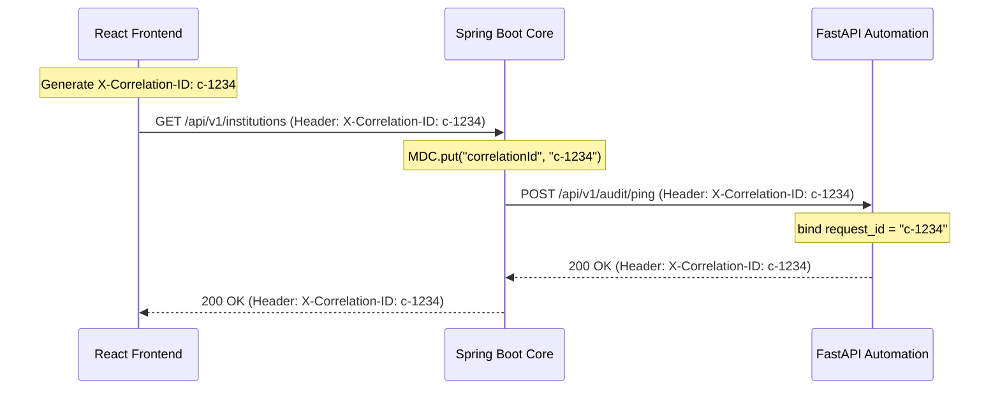

# SAGE API Contracts & Integration Protocols

## 1. Overview & Architectural Principles

SAGE implements RESTful micro-contracts adhering to:
- **RFC 7807 Problem Details** for consistent client error handling.
- **W3C Distributed Tracing / X-Correlation-ID** across all service boundaries.
- **OpenAPI 3.0** documentation automatically generated from source code.
- **Fail-Closed Tenancy Validation** on all resource endpoints.

---

## 2. Health & Readiness Contracts

Both backend (Spring Boot) and automation (FastAPI) expose standardized health contracts.

### A. Core Backend Health Endpoints (`http://localhost:8080`)

#### `GET /api/v1/health`
- **Purpose**: Liveness probe (Kubernetes / Docker Compose).
- **Response**: `200 OK`
```json
{
  "status": "UP",
  "service": "sage-backend",
  "timestamp": "2026-10-29T04:15:00Z",
  "version": "1.0.0-SNAPSHOT"
}
```

#### `GET /api/v1/health/ready`
- **Purpose**: Readiness probe (validates database connectivity and migration status).
- **Response**: `200 OK` (when DB is healthy) or `503 Service Unavailable`
```json
{
  "status": "UP",
  "service": "sage-backend",
  "database": {
    "status": "UP",
    "details": "PostgreSQL connection validated"
  },
  "timestamp": "2026-10-29T04:15:00Z"
}
```

---

### B. Python Automation Health Endpoints (`http://localhost:8000`)

#### `GET /api/v1/health`
- **Purpose**: Liveness probe.
- **Response**: `200 OK`
```json
{
  "status": "UP",
  "service": "sage-automation",
  "version": "1.0.0",
  "timestamp": "2026-10-29T04:15:00Z"
}
```

#### `GET /api/v1/health/ready`
- **Purpose**: Readiness probe (verifies dependencies and backend reachability).
- **Response**: `200 OK`
```json
{
  "status": "UP",
  "service": "sage-automation",
  "backendReachable": true,
  "timestamp": "2026-10-29T04:15:00Z"
}
```

---

## 3. Standard Error Format (RFC 7807)

Every non-2xx response from Spring Boot or FastAPI conforms to RFC 7807:

```json
{
  "type": "https://api.aicte.gov.in/errors/resource-not-found",
  "title": "Resource Not Found",
  "status": 404,
  "detail": "Institution with ID '3f2b8a1c-...' was not found.",
  "instance": "/api/v1/institutions/3f2b8a1c-...",
  "correlationId": "8b92d64f-46df-4998-8924-c117d3325c89",
  "timestamp": "2026-10-29T04:15:00Z",
  "fieldErrors": [
    {
      "field": "code",
      "rejectedValue": "",
      "message": "AICTE Permanent ID is required."
    }
  ]
}
```

---

## 4. Authentication & Authorization API Endpoints

### `POST /api/v1/auth/login`
- **Access**: Public
- **Request Body**:
```json
{
  "username": "admin@aicte.gov.in",
  "password": "Password123!"
}
```
- **Success Response**: `200 OK`
```json
{
  "accessToken": "eyJhbGciOiJIUzI1NiIsInR5cCI6...",
  "tokenType": "Bearer",
  "expiresInMs": 86400000,
  "user": {
    "id": "11111111-1111-1111-1111-111111111111",
    "username": "admin@aicte.gov.in",
    "fullName": "AICTE Central Administrator",
    "roles": ["ROLE_AICTE_ADMIN"],
    "institutions": []
  }
}
```
- **Error Response**: `401 Unauthorized` (Invalid credentials) or `400 Bad Request` (Validation error).

---

### `GET /api/v1/auth/me`
- **Access**: Authenticated (`Bearer <token>`)
- **Success Response**: `200 OK` (Current user profile with role & tenant bindings).

---

## 5. Institution Resource API Endpoints

### `GET /api/v1/institutions`
- **Access**: Authenticated (`ROLE_AICTE_ADMIN`, `ROLE_REGIONAL_OFFICER`, `ROLE_INSTITUTION_OFFICER`).
- **Tenancy Behavior**:
  - `ROLE_AICTE_ADMIN`: Returns all institutions in the system.
  - `ROLE_INSTITUTION_OFFICER`: Automatically scoped only to the institutions where the user is an authorized member.
- **Success Response**: `200 OK`
```json
[
  {
    "id": "22222222-2222-2222-2222-222222222222",
    "code": "1-500123498",
    "name": "Delhi Institute of Advanced Engineering & Technology",
    "applicationType": "ENGINEERING_AND_TECH",
    "state": "Delhi",
    "district": "New Delhi",
    "status": "ACTIVE",
    "version": 0,
    "createdAt": "2026-10-29T00:00:00Z",
    "updatedAt": "2026-10-29T00:00:00Z"
  }
]
```

### `GET /api/v1/institutions/{id}`
- **Access**: Authenticated.
- **Tenancy Behavior**:
  - If the caller belongs to another institution and is not an AICTE Admin, the endpoint returns `403 Forbidden` (`TenantIsolationException`).
- **Success Response**: `200 OK`

### `POST /api/v1/institutions`
- **Access**: `ROLE_AICTE_ADMIN` only.
- **Request Body**:
```json
{
  "code": "1-998877665",
  "name": "National College of Artificial Intelligence",
  "applicationType": "ENGINEERING_AND_TECH",
  "state": "Maharashtra",
  "district": "Pune"
}
```
- **Success Response**: `201 Created`

---

## 6. Correlation ID Propagation Protocol


