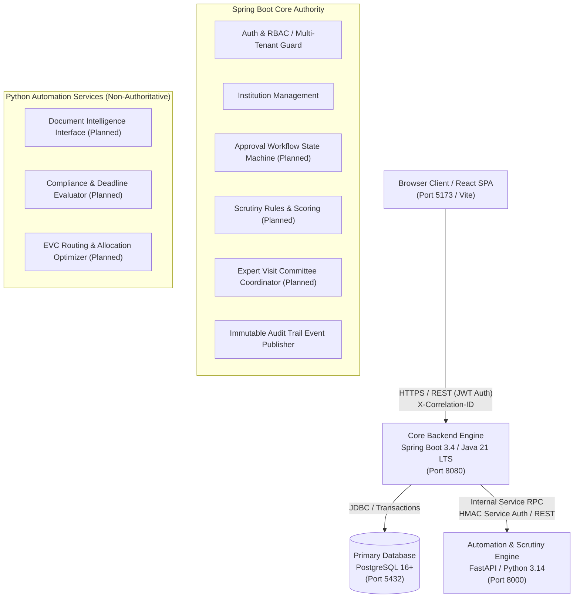

# SAGE System Architecture — Phase 1 Foundation

## 1. Executive Summary & Objective

**SAGE** (Smart AICTE Guidance and Evaluation) is an automated, modular, compliance-monitoring, and workflow execution platform tailored to **SIH 2026 Problem Statement 26262**:
> *"Integrated AICTE Approval Workflow Automation, Compliance Monitoring and Alert Management System."*

The platform transitions AICTE's annual approval processes from manual, error-prone scrutiny toward an automation-first, multi-tenant, auditable workflow engine.

---

## 2. System Topology and Core Responsibilities



### Component Boundaries & Separation of Concerns

1. **Spring Boot Backend (Core Authority)**:
   - **Authoritative Data & State Owner**: The only component permitted to execute transactional mutations on workflow states, institution approvals, user credentials, and audit logs.
   - **Multi-Tenant Security Enforcement**: Ensures every request is scoped to authorized institutions. Cross-institution access attempts are denied immediately at the service layer.
   - **Auditing**: Publishes immutable audit logs to `audit_events` for any consequential read or write.
   - **OpenAPI & Standard Contracts**: Serves Swagger UI and adheres strictly to RFC 7807 Problem Details for error reporting.

2. **Python Automation Engine (Calculation & Scrutiny Assistant)**:
   - **Stateless Intelligence & Automation**: Houses document intelligence, OCR verification, geospatial clustering for EVC panel allocation, and algorithmic deadline monitoring.
   - **Non-Authoritative Execution**: The Python service *never* directly writes to application tables or modifies workflow status directly in PostgreSQL. Instead, it processes data passed to it or calls authenticated Spring Boot REST endpoints with calculated results.
   - **Async Interfaces**: Defines clear protocol/interface boundaries for workers without prematurely introducing heavyweight distributed message brokers (Celery/Kafka) during Phase 1.

3. **React Frontend (Administrative & Institutional Portal)**:
   - **User Experience**: Single Page Application built on React 18/19, TypeScript, Vite, TanStack Query, and React Router.
   - **Tenant & Role Awareness**: Renders contextual dashboards based on verified backend token claims (AICTE HQ Administrator, Regional Officer, Scrutiny Officer, Institution Representative).
   - **Zero Client-Side Trust**: All authorization checks in the UI are purely UX conveniences; the Spring Boot backend performs authoritative validation on every request.

4. **PostgreSQL Relational Store**:
   - Version-controlled migrations driven exclusively by **Flyway**.
   - No auto-DDL (`ddl-auto: none`) in production or staging.
   - Enforces referential integrity, indexes on lookup paths, optimistic locking via `@Version`, and JSONB payloads for non-authoritative event metadata.

---

## 3. Request Flow & Cross-Cutting Concerns

### A. Request Tracing with Correlation IDs
Every incoming HTTP request through the React frontend, external client, or internal automation hook is assigned an `X-Correlation-ID` (UUIDv4) header:
1. `CorrelationIdFilter` on Spring Boot captures or generates `X-Correlation-ID` and stores it in SLF4J MDC (Mapped Diagnostic Context).
2. The correlation ID is included in all log statements, error payloads, audit entries, and outgoing HTTP calls to the Python service.
3. FastAPI's correlation middleware extracts the header, binds it to request context, and echoes it back in responses.

### B. Standard Error Representation (RFC 7807)
All error responses across all services follow standard `ProblemDetails`:
```json
{
  "type": "https://api.aicte.gov.in/errors/tenant-access-denied",
  "title": "Access Denied",
  "status": 403,
  "detail": "Authenticated user is not authorized to access Institution ID: 9f8e7d6c-...",
  "instance": "/api/v1/institutions/9f8e7d6c-...",
  "correlationId": "4a71b2d3-9f12-4821-b0e2-63bc18084a91",
  "timestamp": "2026-10-29T04:00:00Z"
}
```

---

## 4. Subsystem Module Structure

### Java Backend Modules (`org.aicte.sage`)
- `common/`: Core abstractions, API error models, correlation filters, authoritative authorization evaluator, pagination safety utils.
- `modules/auth/`: JWT authentication, login flow, token verification, server-side token revocation (`TokenRevocationService`).
- `modules/governance/`: Regional jurisdiction assignments, case assignments, and APH statutory committee appointments (`committee_appointments`).
- `modules/users/`: User entity, role assignments, user repository and query services.
- `modules/institutions/`: Institution domain, tenancy scoping, institution profile management.
- `modules/audit/`: Audit event listener, transactional outbox persistence repository, scoped query API.
- `modules/applications/`: AICTE approval application submission, lifecycle management, and course/branch specifications (`ApplicationCourseDetails`, `ApplicationBranchDetails`).
- `modules/workflow/`: Versioned workflow state machines (`WF_NEW_INSTITUTION`, `WF_EOA`, `WF_INCREASE_INTAKE`, `WF_NEW_COURSE_INTRODUCTION`, `WF_NEW_BRANCH_INTRODUCTION`).
- `modules/scrutiny/`: Automated APH deficiency checking, scoring, and course/branch cadre & lab norms.
- `modules/evc/`: Google OR-Tools CP-SAT Expert Visit Committee constraint scheduling engine.
- `modules/compliance/`: Continuous regulatory monitoring and distributed lock-protected sweeps.
- `modules/deadlines/`: Statutory milestone calculation and alert escalation.
- `modules/notifications/`: Multi-channel alerts (Email, SMS, Portal).
- `modules/documents/`: Enterprise institution document compliance registry, immutable versioning (`v1` → `v2`), magic byte inspection, SHA-256 integrity, expiry surveillance, and corrective action workflows.
- `modules/automation/`: Outbound client calling FastAPI intelligence engine with Indra OCR.

### Python Automation Engine (`app/`)
- `api/v1/endpoints/`: Health endpoints, stub analysis routes.
- `core/`: Config settings via Pydantic, logging, internal authentication.
- `interfaces/`:
  - `background_workers.py`: Protocol definitions for job runners.
  - `deadline_monitoring.py`: Abstract contract for statutory deadline computation.
  - `document_intelligence.py`: Abstract contract for document parsing & OCR checks.
  - `evc_optimization.py`: Abstract contract for committee member route optimization.
  - `notifications.py`: Abstract contract for notification dispatching.
  - `external_integrations.py`: Abstract contract for AICTE master database sync.
