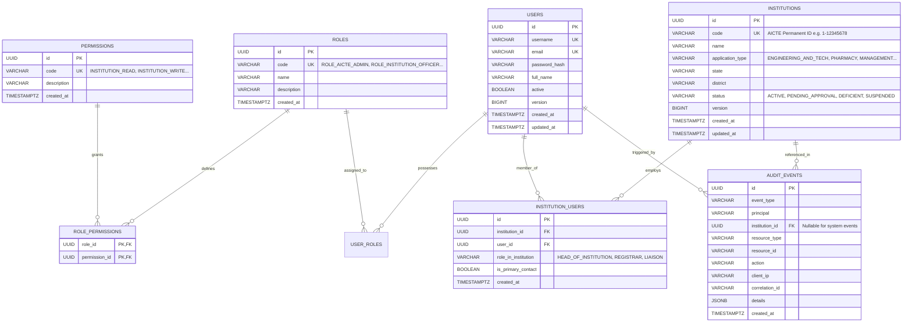

# SAGE Database Design & Flyway Migration Strategy

## 1. Overview and Design Principles

SAGE utilizes **PostgreSQL** as its single source of authoritative regulatory truth. The database design adheres to these strict guidelines:
1. **Flyway Migration Governance**: No Hibernate or JPA DDL auto-generation (`ddl-auto: validate` or `none`). Every schema change is encapsulated in an immutable, forward-only, versioned Flyway SQL migration (`V{N}__{description}.sql`).
2. **Surrogate UUID Primary Keys**: Every primary entity uses UUIDv4 (`UUID` column type) to avoid sequential key enumeration attacks across tenants.
3. **Optimistic Locking**: Transactional records (`institutions`, future `applications`, `workflow_states`) contain a `version BIGINT NOT NULL DEFAULT 0` column to prevent lost-update concurrency anomalies.
4. **Audit Trail Completeness**: Consequential operations are logged to an append-only `audit_events` table with client IP, correlation ID, and JSONB snapshot details.
5. **Multi-Tenant Normalization**: Institutions are linked to users via a many-to-many relationship table `institution_users` with role-in-institution and primary contact flags.

---

## 2. Phase 1 Entity Relationship Diagram

---

## 3. Data Dictionary (Phase 1 Baseline)

### Table: `institutions`
- `id` (UUID, PK): Unique surrogate identifier.
- `code` (VARCHAR(64), UNIQUE, NOT NULL): Official AICTE Permanent Institute ID (PID).
- `name` (VARCHAR(255), NOT NULL): Legal institutional title.
- `application_type` (VARCHAR(64), NOT NULL): Primary discipline approved by AICTE.
- `state` (VARCHAR(100), NOT NULL): State / UT for regional jurisdiction routing.
- `district` (VARCHAR(100), NOT NULL): District locator.
- `status` (VARCHAR(32), NOT NULL): Lifecycle state (`ACTIVE`, `PENDING_SCRUTINY`, `EVC_SCHEDULED`, etc.).
- `version` (BIGINT, NOT NULL, DEFAULT 0): Optimistic locking version.
- `created_at` / `updated_at` (TIMESTAMPTZ, NOT NULL): UTC audit timestamps.

### Table: `institution_users`
- `id` (UUID, PK): Record ID.
- `institution_id` (UUID, NOT NULL, FK -> `institutions.id` ON DELETE CASCADE): Scoped tenant.
- `user_id` (UUID, NOT NULL, FK -> `users.id` ON DELETE CASCADE): User with granted tenancy access.
- `role_in_institution` (VARCHAR(64), NOT NULL): Domain role within the college.
- `is_primary_contact` (BOOLEAN, NOT NULL, DEFAULT FALSE): Primary regulatory signatory flag.
- `created_at` (TIMESTAMPTZ, NOT NULL): Timestamp when affiliation was granted.
- Unique Index: `(institution_id, user_id)` preventing duplicate mappings.

### Table: `audit_events`
- `id` (UUID, PK): Audit record UUID.
- `event_type` (VARCHAR(64), NOT NULL): Categorized event code.
- `principal` (VARCHAR(128), NOT NULL): Username or service identifier executing the operation.
- `institution_id` (UUID, NULL, FK -> `institutions.id`): Institution involved in the event.
- `resource_type` (VARCHAR(64), NOT NULL): Target entity type (`INSTITUTION`, `APPLICATION`, etc.).
- `resource_id` (VARCHAR(128), NOT NULL): Primary key of the affected target entity.
- `action` (VARCHAR(32), NOT NULL): HTTP/Domain action (`CREATE`, `READ`, `UPDATE`, `DELETE`, `AUTH_CHECK`).
- `client_ip` (VARCHAR(64)): Remote IP address of the caller.
- `correlation_id` (VARCHAR(64)): Distributed trace identifier (`X-Correlation-ID`).
- `details` (JSONB): Structured contextual diff, payload summary, or failure reason.
- `created_at` (TIMESTAMPTZ, NOT NULL): Tamper-resistant UTC event timestamp.
- Indexes:
  - `idx_audit_events_inst`: `(institution_id, created_at DESC)`
  - `idx_audit_events_principal`: `(principal, created_at DESC)`
  - `idx_audit_events_correlation`: `(correlation_id)`

---

## 4. Flyway Migration Versioning Rules

Migrations are stored in `backend/src/main/resources/db/migration/`:
- `V1__init_auth_and_institutions.sql`: Complete DDL schema creation with constraints and indexes.
- `V2__dev_seed_data.sql`: Controlled non-production synthetic reference data. Only loaded in the `dev` profile.

**Non-Destructive Evolution Policy**:
1. Never edit a migration file after it has run in any shared environment.
2. Changes to existing structures must be implemented via additive `V{N+1}` migration scripts.
3. No dropping of existing columns; deprecate columns first, then clean up in subsequent releases.
