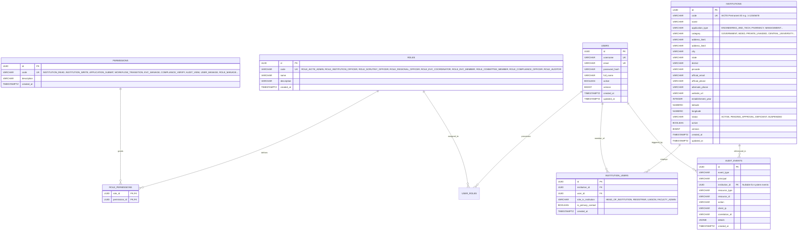

# SAGE Database Design & Flyway Migration Strategy

## 1. Overview and Design Principles

SAGE utilizes **PostgreSQL** as its single source of authoritative regulatory truth. The database design adheres to these strict guidelines:
1. **Flyway Migration Governance**: No Hibernate or JPA DDL auto-generation (`ddl-auto: validate` or `none`). Every schema change is encapsulated in an immutable, forward-only, versioned Flyway SQL migration (`V{N}__{description}.sql`).
2. **Surrogate UUID Primary Keys**: Every primary entity uses UUIDv4 (`UUID` column type) to avoid sequential key enumeration attacks across tenants.
3. **Optimistic Locking**: Transactional records (`institutions`, future `applications`, `workflow_states`) contain a `version BIGINT NOT NULL DEFAULT 0` column to prevent lost-update concurrency anomalies.
4. **Audit Trail Completeness**: Consequential operations are logged to an append-only `audit_events` table with client IP, correlation ID, and JSONB snapshot details.
5. **Multi-Tenant Normalization**: Institutions are linked to users via a many-to-many relationship table `institution_users` with role-in-institution and primary contact flags.

---

## 2. Entity Relationship Diagram (Phase 2)

---

## 3. Data Dictionary (Phase 2 Specification)

### Table: `institutions`
- `id` (UUID, PK): Unique surrogate identifier.
- `code` (VARCHAR(64), UNIQUE, NOT NULL): Official AICTE Permanent Institute ID (PID).
- `name` (VARCHAR(255), NOT NULL): Legal institutional title.
- `application_type` (VARCHAR(64), NOT NULL): Primary discipline approved by AICTE.
- `category` (VARCHAR(64)): Institutional governance category (`GOVERNMENT`, `GOVERNMENT_AIDED`, `PRIVATE_SELF_FINANCED`, `CENTRAL_UNIVERSITY`, `STATE_UNIVERSITY`, `DEEMED_UNIVERSITY`).
- `address_line1` (VARCHAR(255)): Street address / campus location line 1.
- `address_line2` (VARCHAR(255)): Additional campus location details.
- `city` (VARCHAR(100)): City / town location.
- `state` (VARCHAR(100), NOT NULL): State / UT for regional jurisdiction routing.
- `district` (VARCHAR(100), NOT NULL): District locator.
- `pincode` (VARCHAR(12)): Postal code.
- `official_email` (VARCHAR(128)): Regulatory contact email.
- `official_phone` (VARCHAR(32)): Landline / official phone number.
- `alternate_phone` (VARCHAR(32)): Emergency or secondary contact number.
- `website_url` (VARCHAR(255)): Official website URL.
- `establishment_year` (INTEGER): Year institution was established.
- `latitude` (NUMERIC(10, 7)): GIS coordinate latitude.
- `longitude` (NUMERIC(10, 7)): GIS coordinate longitude.
- `status` (VARCHAR(32), NOT NULL): Regulatory lifecycle state (`ACTIVE`, `PENDING_APPROVAL`, `DEFICIENT`, `SUSPENDED`).
- `active` (BOOLEAN, NOT NULL, DEFAULT TRUE): Operational administrative status.
- `version` (BIGINT, NOT NULL, DEFAULT 0): Optimistic locking version.
- `created_at` / `updated_at` (TIMESTAMPTZ, NOT NULL): UTC audit timestamps.

### Table: `users`
- `id` (UUID, PK): Unique surrogate identifier.
- `username` (VARCHAR(64), UNIQUE, NOT NULL): Login handle.
- `email` (VARCHAR(128), UNIQUE, NOT NULL): Verified email address.
- `password_hash` (VARCHAR(255), NOT NULL): BCrypt hash (`$2a$10$...`).
- `full_name` (VARCHAR(128), NOT NULL): Human-readable name.
- `active` (BOOLEAN, NOT NULL, DEFAULT TRUE): Administrative status flag.
- `version` (BIGINT, NOT NULL, DEFAULT 0): Optimistic locking counter.
- `created_at` / `updated_at` (TIMESTAMPTZ, NOT NULL): Timestamps.

### Table: `institution_users`
- `id` (UUID, PK): Record ID.
- `institution_id` (UUID, NOT NULL, FK -> `institutions.id` ON DELETE CASCADE): Scoped tenant.
- `user_id` (UUID, NOT NULL, FK -> `users.id` ON DELETE CASCADE): User with granted tenancy access.
- `role_in_institution` (VARCHAR(64), NOT NULL): Domain role within the college.
- `is_primary_contact` (BOOLEAN, NOT NULL, DEFAULT FALSE): Primary regulatory signatory flag.
- `created_at` (TIMESTAMPTZ, NOT NULL): Timestamp when affiliation was granted.
- Unique Index: `(institution_id, user_id)` preventing duplicate mappings.

### Table: `audit_events`
- `id` (UUID, PK): Audit record UUID.
- `event_type` (VARCHAR(64), NOT NULL): Categorized event code (`AUTH_LOGIN_SUCCESS`, `AUTH_LOGOUT`, `TENANCY_VIOLATION_ATTEMPT`, `INSTITUTION_UPDATE`, etc.).
- `principal` (VARCHAR(128), NOT NULL): Username or service identifier executing the operation.
- `institution_id` (UUID, NULL, FK -> `institutions.id`): Institution involved in the event.
- `resource_type` (VARCHAR(64), NOT NULL): Target entity type (`INSTITUTION`, `USER`, `AUTH`).
- `resource_id` (VARCHAR(128), NOT NULL): Primary key or reference of affected entity.
- `action` (VARCHAR(32), NOT NULL): Action (`CREATE`, `READ`, `UPDATE`, `DELETE`, `STATUS_CHANGE`, `SECURITY_BLOCK`).
- `client_ip` (VARCHAR(64)): Remote IP address of the caller.
- `correlation_id` (VARCHAR(64)): Distributed trace identifier (`X-Correlation-ID`).
- `details` (JSONB): Structured contextual diff, payload summary, or failure reason.
- `created_at` (TIMESTAMPTZ, NOT NULL): Tamper-resistant UTC event timestamp.
- Indexes:
  - `idx_audit_events_inst`: `(institution_id, created_at DESC)`
  - `idx_audit_events_principal`: `(principal, created_at DESC)`
  - `idx_audit_events_correlation`: `(correlation_id)`
  - `idx_audit_events_created`: `(created_at DESC)`

### Table: `jurisdiction_assignments`
- `id` (UUID, PK): Unique assignment identifier.
- `user_id` (UUID, NOT NULL, FK -> `users.id` ON DELETE CASCADE): Regional Officer.
- `region` (VARCHAR(64), NOT NULL): AICTE region code (`NORTHERN`, `WESTERN`, `SOUTHERN`, etc.).
- `state` (VARCHAR(100), NOT NULL): State or UT jurisdiction, or `*` for broad jurisdiction.
- `active` (BOOLEAN, NOT NULL, DEFAULT TRUE): Active validity toggle.
- `valid_from` / `valid_until` (TIMESTAMPTZ): Period of statutory appointment.
- `created_at` (TIMESTAMPTZ, NOT NULL): Creation timestamp.

### Table: `case_assignments`
- `id` (UUID, PK): Record ID.
- `user_id` (UUID, NOT NULL, FK -> `users.id` ON DELETE CASCADE): Assigned officer or expert reviewer.
- `institution_id` (UUID, NOT NULL, FK -> `institutions.id` ON DELETE CASCADE): Target institution.
- `assignment_type` (VARCHAR(64), NOT NULL): Purpose (`SCRUTINY`, `EVC_VISIT`, `COMPLIANCE_MONITORING`, `AUDIT_REVIEW`).
- `case_reference` (VARCHAR(128)): Formal file number / case identifier.
- `active` (BOOLEAN, NOT NULL, DEFAULT TRUE): Assignment status.
- `assigned_at` / `valid_until` (TIMESTAMPTZ): Assignment timeline.

### Table: `committee_appointments`
- `id` (UUID, PK): Record ID.
- `user_id` (UUID, NOT NULL, FK -> `users.id` ON DELETE CASCADE): Appointed committee member.
- `committee_type` (VARCHAR(64), NOT NULL): Statutory committee per APH 2024-27 (`SCRUTINY_CH1`, `SCRUTINY_CH2`, `EVC`, `SHC`, `SAC`, `SCSC`, `EXECUTIVE_COMMITTEE`, `COUNCIL`).
- `role_in_committee` (VARCHAR(64), NOT NULL): Function (`CHAIRMAN`, `EXPERT_MEMBER`, `ARCHITECT_MEMBER`, `ADVOCATE_MEMBER`, `MEMBER_SECRETARY`).
- `qualification_details` (VARCHAR(255)): Verified credentials and qualification basis per APH Annexure 16.
- `active` (BOOLEAN, NOT NULL, DEFAULT TRUE): Appointment validity.
- `valid_from` / `valid_until` (TIMESTAMPTZ, NOT NULL): Statutory term of appointment.

### Table: `token_revocations`
- `id` (UUID, PK): Record ID.
- `token_id` (VARCHAR(128), UNIQUE, NOT NULL): Unique JWT ID (`jti`).
- `user_id` (UUID, NOT NULL, FK -> `users.id` ON DELETE CASCADE): User whose session was terminated.
- `revoked_at` (TIMESTAMPTZ, NOT NULL): Timestamp when explicit server-side logout was triggered.
- `expires_at` (TIMESTAMPTZ, NOT NULL): Natural expiration timestamp of the token for cleanup.
- `reason` (VARCHAR(255)): Reason for revocation (`User explicit server-side logout`, `Account suspended`, etc.).

### Table: `application_course_details` (V14)
- `id` (UUID, PK): Record ID.
- `application_id` (UUID, NOT NULL, UNIQUE, FK -> `applications.id` ON DELETE CASCADE): Parent approval application.
- `course_name` (VARCHAR(255), NOT NULL): Proposed course title (e.g. B.Tech Robotics).
- `programme_level` (VARCHAR(64), NOT NULL): `UNDERGRADUATE`, `POSTGRADUATE`, `DIPLOMA`.
- `degree_type` (VARCHAR(64), NOT NULL): `BACHELOR_OF_TECHNOLOGY`, `MASTER_OF_TECHNOLOGY`, etc.
- `course_discipline` (VARCHAR(128), NOT NULL): Engineering, Pharmacy, Management, etc.
- `proposed_intake` (INTEGER, NOT NULL): Proposed seat count.
- `mode_of_delivery` (VARCHAR(32), DEFAULT 'FULL_TIME'): Delivery mode.
- `duration_years` (INTEGER, DEFAULT 4): Programme duration.
- `laboratories_count` (INTEGER, DEFAULT 0): Dedicated laboratories setup.
- `professors_count`, `associate_professors_count`, `assistant_professors_count` (INTEGER): Cadre breakdown.
- `faculty_student_ratio` (VARCHAR(32)): Cadre ratio compliance status.
- `laboratory_details`, `equipment_details`, `infrastructure_notes` (TEXT): Equipment and facilities.

### Table: `application_branch_details` (V14)
- `id` (UUID, PK): Record ID.
- `application_id` (UUID, NOT NULL, UNIQUE, FK -> `applications.id` ON DELETE CASCADE): Parent application.
- `existing_programme` (VARCHAR(128), NOT NULL): Parent discipline.
- `existing_department` (VARCHAR(255), NOT NULL): Host department.
- `proposed_branch_name` (VARCHAR(255), NOT NULL): Specialization (e.g. AI & Data Science).
- `proposed_intake` (INTEGER, NOT NULL): Proposed branch seats.
- `existing_approved_intake` (INTEGER): Existing parent seats.
- `faculty_count`, `laboratory_count` (INTEGER): Allocated resources.

### Table: `document_corrective_actions` (V14)
- `id` (UUID, PK): Record ID.
- `document_id` (UUID, NOT NULL, FK -> `documents.id` ON DELETE CASCADE): Targeted document.
- `institution_id` (UUID, NOT NULL, FK -> `institutions.id` ON DELETE CASCADE): Tenant institution.
- `finding_id` (UUID, FK -> `scrutiny_findings.id`): Optional linked finding.
- `action_type` (VARCHAR(64), NOT NULL): Action classification.
- `title` (VARCHAR(255), NOT NULL): Summary title.
- `description` (TEXT, NOT NULL): Statutory deficiency explanation.
- `due_date` (TIMESTAMPTZ, NOT NULL): Remediation deadline.
- `status` (VARCHAR(64), NOT NULL, DEFAULT 'OPEN'): `OPEN`, `SUBMITTED_FOR_REVIEW`, `RESOLVED`, `REJECTED`.
- `institution_response` (TEXT): Institutional explanation.
- `resolution_evidence_doc_id` (UUID, FK -> `documents.id`): Uploaded evidence.
- `officer_notes` (TEXT): Officer verification comments.
- `resolved_by` (UUID, FK -> `users.id`), `resolved_at` (TIMESTAMPTZ).

---

## 4. Flyway Migration Versioning Catalog

Migrations are stored in `backend/src/main/resources/db/migration/` (and profile seeds in `db/seed/`):
- `V1__init_auth_and_institutions.sql`: Complete DDL baseline schema with constraints and indexes.
- `V2__dev_seed_data.sql`: Phase 1 synthetic reference seed.
- `V3__phase2_institution_details_and_roles.sql`: Institutional profile fields, 4 statutory roles, granular permissions.
- `V4__phase2_seed_data.sql`: Non-production demonstration institutions and user accounts.
- `V5__authorization_governance_and_aph_alignment.sql`: Governance tables (`jurisdiction_assignments`, `case_assignments`, `committee_appointments`, `token_revocations`).
- `V6__phase2_assignments_seed.sql`: Demonstration assignments and SCSC committee appointments.
- `V7__phase3_applications_and_workflow.sql`: Applications, workflow definitions, states, transitions, documents, extracted fields, and scrutiny findings.
- `V8__phase3_seed_data.sql`: Phase 3 sample applications and workflows (`WF_NEW_INSTITUTION`, `WF_EOA`, `WF_INCREASE_INTAKE`).
- `V9__phase4_compliance_and_alerts.sql`: Compliance monitoring schedules, statutory deadlines, alert records, and notification templates.
- `V10__phase4_seed_data.sql`: Compliance monitoring seeds.
- `V11__evc_scheduling_engine.sql`: Expert profiles, panel records, and OR-Tools scheduling solver constraints.
- `V12__evc_seed_data.sql`: Synthetic expert availability data.
- `V13__distributed_job_locks.sql`: High-availability distributed job lock table for clustered scheduler sweeps.
- `V14__new_course_branch_and_document_compliance.sql`: Schema migration uncoupling documents from applications, adding document validity/versioning columns, creating `application_course_details`, `application_branch_details`, and `document_corrective_actions`.
- `V15__new_course_branch_seed_data.sql`: Workflow definitions (`WF_NEW_COURSE_INTRODUCTION`, `WF_NEW_BRANCH_INTRODUCTION`) and APH scrutiny rules (`RULE_APH_COURSE_FACULTY_RATIO`, `RULE_APH_COURSE_LABORATORY`, etc.).

**Non-Destructive Evolution Policy**:
1. Never edit a migration file after it has run in any shared environment.
2. Changes to existing structures must be implemented via additive `V{N+1}` migration scripts.
3. No dropping of existing columns; deprecate columns first, then clean up in subsequent releases.
4. Keep migrations portable (pure ANSI SQL) to ensure seamless execution on both PostgreSQL and H2 in-memory test databases.
