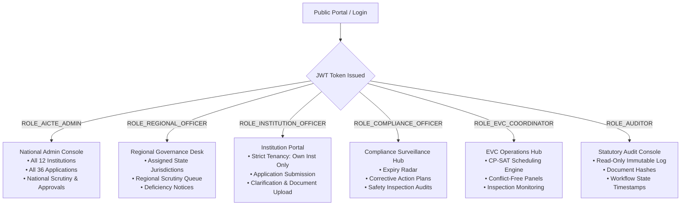

# SAGE — Demonstration Accounts & Role Governance Directory

> **CONFIDENTIAL — DEVELOPMENT & EVALUATION ENVIRONMENT ONLY**  
> *Do not deploy or distribute outside secure evaluation and staging environments.*  
> *All passwords are encrypted with BCrypt (`$2a$10$9Zj422FbkPlFPBveLlulK.oJ5o4nuF6aownRmGmFFGad97I2fQ/Vi`).*

---

## 1. Global Demonstration Credentials

For evaluation convenience, all pre-seeded regulatory and institutional accounts share a standardized password:

| Parameter | Demonstration Value |
| :--- | :--- |
| **Default Password** | `Password123!` |
| **Authentication Type** | State-of-the-Art JWT Bearer (`HS256`) + Authoritative DB Role Verification |
| **MFA / 2FA Simulation** | Optional TOTP bypass enabled in `dev` profile |

---

## 2. Regulatory & Statutory Oversight Accounts

| Name & Designation | Email Address | Role | Jurisdictional / Operational Scope |
| :--- | :--- | :--- | :--- |
| **Dr. Surendra Prasad** Central Admin Lead | `admin@aicte-demo.gov.in` | `ROLE_AICTE_ADMIN` | **Nationwide (All States & Regions)** Full policy enforcement, national metrics, workflow overrides, final approval confirmations. |
| **Dr. Arvind Saxena** Northern Regional Director | `regional.north@aicte-demo.gov.in` | `ROLE_REGIONAL_OFFICER` | **Northern Region** Jurisdiction over `Delhi`, `Uttar Pradesh`, `Uttarakhand`, `Haryana`. Scrutiny reviews, deficiency notices. |
| **Dr. Vikram Deshmukh** Western Regional Director | `regional.west@aicte-demo.gov.in` | `ROLE_REGIONAL_OFFICER` | **Western Region** Jurisdiction over `Maharashtra`, `Gujarat`, `Rajasthan`, `Goa`. Scrutiny reviews, regional hearings. |
| **Shri R. K. Mittal** Surveillance & Safety Lead | `compliance.officer1@aicte-demo.gov.in` | `ROLE_COMPLIANCE_OFFICER` | **National Safety Surveillance** Fire safety certificates, building stability, land ownership compliance, corrective actions. |
| **Smt. Ananya Sen** Regulatory Compliance Monitor | `compliance.officer2@aicte-demo.gov.in` | `ROLE_COMPLIANCE_OFFICER` | **Academic Infrastructure & Faculty Compliance** Faculty cadres, student-teacher ratio audits, laboratory compliance. |
| **Shri Harish Chand** Senior Statutory Auditor | `auditor@aicte-demo.gov.in` | `ROLE_AUDITOR` | **Nationwide Read-Only Audit Surveillance** Immutable regulatory audit log, transition timestamps, SHA-256 document verifications. |
| **Dr. Anand Kulkarni** EVC Central Operations | `evc.coord1@aicte-demo.gov.in` | `ROLE_EVC_COORDINATOR` | **Nationwide EVC Scheduling** Expert Visit Committee formation, CP-SAT optimization engine, expert conflict resolution. |
| **Prof. Shalini Roy** EVC Panel Allocation Manager | `evc.coord2@aicte-demo.gov.in` | `ROLE_EVC_COORDINATOR` | **Committee Panel Oversight** Expert availability management, panel acceptance tracking, inspection report reviews. |

---

## 3. Institutional Officer Accounts (Multi-Tenant Technical Institutions)

Each institutional officer is strictly isolated to their assigned institution. Direct access or cross-tenant URL access attempts will result in `403 Forbidden` (`TENANCY_VIOLATION_ATTEMPT` audit entry).

| Institution Name | State & Region | Permanent AICTE Ref | Officer Name | Email Address |
| :--- | :--- | :--- | :--- | :--- |
| **Northern Institute of Technology** | New Delhi (Northern) | `1-500123498` | Prof. R. Ramanathan | `officer@delhi-tech.edu` |
| **Western Institute of Engineering** | Mumbai, Maharashtra (Western) | `1-500287411` | Dr. Sunita Kulkarni | `officer@mumbai-engg.edu` |
| **Southern Technical College** | Bengaluru, Karnataka (Southern) | `1-500399120` | Prof. K. Venkatesh | `officer@bengaluru-poly.edu` |
| **National Institute of Management & Research** | Pune, Maharashtra (Western) | `1-500412893` | Dr. Deepak Joshi | `officer@pune-nimr.ac.in` |
| **Chennai School of Architecture & Urban Planning** | Chennai, Tamil Nadu (Southern) | `1-500589123` | Prof. V. Soundararajan | `officer@csaup.edu.in` |
| **Central Institute of Computing** | Bhopal, Madhya Pradesh (Central) | `1-500600101` | Dr. Manoj Tiwari | `officer@bhopal-comp.edu` |
| **Rajasthan College of Engineering** | Jaipur, Rajasthan (North-Western) | `1-500700202` | Dr. Rajendra Shekhawat | `officer@jaipur-engg.edu` |
| **Himalayan Institute of Technology** | Dehradun, Uttarakhand (Northern) | `1-500800303` | Prof. Alok Rawat | `officer@dehradun-hit.edu` |
| **Coastal Engineering Institute** | Visakhapatnam, Andhra Pradesh (South-Central) | `1-500900404` | Dr. S. R. Murthy | `officer@vizag-coast.edu` |
| **Deccan Institute of Technology** | Hyderabad, Telangana (South-Central) | `1-501000505` | Dr. P. V. Rao | `officer@hyderabad-dit.edu` |
| **Greenfield College of Engineering** | Gurugram, Haryana (Northern) | `1-501100606` | Prof. Kuldeep Yadav | `officer@gurugram-gce.edu` |
| **Eastern School of Technology** | Kolkata, West Bengal (Eastern) | `1-501200707` | Dr. Subrata Mukherjee | `officer@kolkata-tech.edu` |

---

## 4. Evaluator & Peer Expert Registry (EVC Committee Pool)

These 12 senior professors and industry leaders are registered in the EVC expert pool with automated conflict-of-interest checks (experts cannot inspect their own institution or state):

| Expert ID | Full Name | Academic Discipline | Current Designation & Affiliation | Conflict Restrictions |
| :--- | :--- | :--- | :--- | :--- |
| `EXP-01` | **Dr. Rajeshwar Sharma** | Computer Science & AI | Professor & HoD, Delhi Tech | Excluded from `Delhi` & Inst 1 |
| `EXP-02` | **Prof. Meenakshi Sundaram**| Electronics & Communication | Senior Professor, IIT Madras | No conflict in North/West |
| `EXP-03` | **Dr. Amitav Banerjee** | Mechanical & Robotics | Professor, Jadavpur University | Excluded from `West Bengal` |
| `EXP-04` | **Dr. K. S. Radhakrishnan** | Civil & Structural Engg | Chief Structural Consultant, Bengaluru | Excluded from `Karnataka` |
| `EXP-05` | **Prof. Hemant Deshpande** | Information Technology | Professor, COEP Tech Pune | Excluded from `Maharashtra` |
| `EXP-06` | **Dr. Suniti Sen** | Electrical & Power Systems | Professor, VNIT Nagpur | Excluded from `Maharashtra` |
| `EXP-07` | **Prof. B. K. Sengupta** | Architecture & Town Planning | Dean Emeritus, CEPT Ahmedabad | Excluded from `Gujarat` |
| `EXP-08` | **Dr. Satish Chandra** | Applied Sciences & Materials | Senior Scientist, CSIR Roorkee | Excluded from `Uttarakhand` |
| `EXP-09` | **Prof. Arvind Kejriwal** | Data Science & Computing | Professor, MANIT Bhopal | Excluded from `Madhya Pradesh` |
| `EXP-10` | **Dr. M. G. Ramachandran** | AI & Machine Learning | Chair Professor, Osmania University | Excluded from `Telangana` |
| `EXP-11` | **Prof. Sanjeev Kumar** | Mechanical & Manufacturing | Professor, MNIT Jaipur | Excluded from `Rajasthan` |
| `EXP-12` | **Dr. P. N. Murthy** | Chemical & Bio-Engineering | Professor, Andhra University | Excluded from `Andhra Pradesh` |

---

## 5. Security & Access Boundary Matrix

