# SAGE — Demonstration Database Architecture & Entity Relationship Guide

> **System**: SAGE (System for Approval Governance and Evaluation)  
> **Target Problem Statement**: SIH 2026 Problem Statement 26262 (Ministry of Education / AICTE)  
> **Database Targets**: PostgreSQL 16+ (Production / Staging) & H2 in PostgreSQL Mode (Development / CI Test)  
> **Migration & Seeding Strategy**: Flyway Seed Version `V16__comprehensive_relational_demo_seed.sql`

---

## 1. Architectural Philosophy: True Relational Demonstration

Unlike superficial prototypes that rely on frontend-mocked JSON or disconnected dummy rows, SAGE's demonstration database is a **fully connected relational graph**. Every record represents an active regulatory participant or event within the statutory AICTE approval lifecycle:

1. **Strict Foreign-Key Integrity**: Every application is tied to an authorized institution, which is tied to an institutional signatory, who is authenticated via BCrypt-hashed credentials.
2. **Authoritative Access Boundaries**: Institutional officers can only read and mutate their own institution's applications and documents (`AuthoritativeAuthorizationService.java`). Cross-tenant access is rejected with `403 Forbidden` and audited.
3. **Real Cryptographic Vault**: Every seeded statutory document in the database (`documents` table) points to an actual physical file in `backend/data/documents/<uuid>.pdf` with `%PDF-1.4` headers, readable OCR demonstration text, exact byte lengths, and valid SHA-256 hashes.
4. **Permitted State Machine Transitions**: No impossible states exist. Approved applications have complete chronological workflow histories (`workflow_transitions`), valid scrutiny evaluations (`scrutiny_evaluations`), and completed EVC inspection reports where required by the Approval Process Handbook (APH 2024-27).

---

## 2. Complete Entity-Relationship (ER) Model

```mermaid
erDiagram
    INSTITUTIONS ||--o{ INSTITUTION_USERS : employs
    INSTITUTIONS ||--o{ APPLICATIONS : submits
    INSTITUTIONS ||--o{ DOCUMENTS : owns
    INSTITUTIONS ||--o{ CASE_ASSIGNMENTS : assigned_to
    INSTITUTIONS ||--o{ EVC_INSPECTIONS : inspected_by
    INSTITUTIONS ||--o{ DEADLINES : subject_to
    INSTITUTIONS ||--o{ ALERTS : targets

    USERS ||--o{ USER_ROLES : has
    USERS ||--o{ INSTITUTION_USERS : belongs_to
    USERS ||--o{ JURISDICTION_ASSIGNMENTS : governs
    USERS ||--o{ CASE_ASSIGNMENTS : handles
    USERS ||--o{ APPLICATIONS : creates
    USERS ||--o{ WORKFLOW_TRANSITIONS : acts_on
    USERS ||--o{ SCRUTINY_EVALUATIONS : evaluates
    USERS ||--o{ AUDIT_EVENTS : triggers

    WORKFLOW_DEFINITIONS ||--o{ APPLICATIONS : governs_workflow

    APPLICATIONS ||--o{ WORKFLOW_TRANSITIONS : tracks_history
    APPLICATIONS ||--o{ APPLICATION_COURSE_DETAILS : contains_course
    APPLICATIONS ||--o{ APPLICATION_BRANCH_DETAILS : contains_branch
    APPLICATIONS ||--o{ DOCUMENTS : attaches
    APPLICATIONS ||--o{ SCRUTINY_EVALUATIONS : evaluated_by
    APPLICATIONS ||--o{ SCRUTINY_FINDINGS : has_deficiencies
    APPLICATIONS ||--o{ EVC_INSPECTIONS : requires_visit
    APPLICATIONS ||--o{ ALERTS : triggers_alert

    DOCUMENTS ||--o{ SCRUTINY_FINDINGS : cites
    DOCUMENTS ||--o{ DOCUMENT_CORRECTIVE_ACTIONS : remediated_by
    DOCUMENTS ||--o{ DOCUMENTS : replaces_version

    EXPERTS ||--o{ EXPERT_AVAILABILITIES : declares_dates
    EXPERTS ||--o{ COMMITTEE_ASSIGNMENTS : assigned_to

    EVC_INSPECTIONS ||--o{ COMMITTEE_ASSIGNMENTS : forms_panel
    EVC_INSPECTIONS ||--o{ ALERTS : notifies

    DOCUMENT_CORRECTIVE_ACTIONS ||--o{ ALERTS : generates_notice
```

---

## 3. Core Database Tables & Entity Specifications

### A. Regulatory Tenancy & Governance
| Table Name | Primary Key | Description | Key Foreign Keys & Constraints |
| :--- | :--- | :--- | :--- |
| `institutions` | `UUID` (`id`) | Technical institutions across Indian states with AICTE Permanent Ref. | `UNIQUE(permanent_id)` |
| `users` | `UUID` (`id`) | Regulatory officers, coordinators, auditors, and institutional signatories. | `UNIQUE(username)`, `UNIQUE(email)` |
| `user_roles` | Composite (`user_id`, `role_id`) | Role-based authorization mappings (`ROLE_AICTE_ADMIN`, etc.). | `FK(users.id)` |
| `institution_users` | `UUID` (`id`) | Links institutional officers to specific colleges with designation. | `FK(institutions.id)`, `FK(users.id)` |
| `jurisdiction_assignments` | `UUID` (`id`) | Regional officer jurisdiction by Indian Region and State. | `FK(users.id)` |
| `case_assignments` | `UUID` (`id`) | Direct institutional or application assignment overrides. | `FK(users.id)`, `FK(institutions.id)` |

### B. Approval Workflow & Lifecycle
| Table Name | Primary Key | Description | Key Foreign Keys & Constraints |
| :--- | :--- | :--- | :--- |
| `workflow_definitions` | `UUID` (`id`) | Statutory categories and statutory inspection prerequisites. | `UNIQUE(code)` |
| `applications` | `UUID` (`id`) | Core approval requests with academic year, state, category. | `FK(institutions.id)`, `FK(workflow_definitions.id)` |
| `workflow_transitions` | `UUID` (`id`) | Immutable state audit trail tracking transitions and evidence. | `FK(applications.id)`, `FK(users.id)` |
| `application_course_details`| `UUID` (`id`) | Level, course name, approved and proposed student intake seats. | `FK(applications.id)` |
| `application_branch_details`| `UUID` (`id`) | Specialized branches (e.g. AI/ML, Cyber Security, VLSI). | `FK(applications.id)` |

### C. Document Compliance & Vault
| Table Name | Primary Key | Description | Key Foreign Keys & Constraints |
| :--- | :--- | :--- | :--- |
| `documents` | `UUID` (`id`) | Statutory compliance certificates with SHA-256 and versioning. | `FK(institutions.id)`, `FK(applications.id)`, `FK(previous_version_id)` |
| `scrutiny_evaluations` | `UUID` (`id`) | Rule evaluations performed by regional scrutiny officers. | `FK(applications.id)`, `FK(users.id)` |
| `scrutiny_findings` | `UUID` (`id`) | Individual rule deficiencies, citations, and resolution notes. | `FK(evaluations.id)`, `FK(applications.id)`, `FK(documents.id)` |
| `document_corrective_actions`| `UUID` (`id`)| Corrective action plans tracking expired/deficient certificates. | `FK(documents.id)`, `FK(institutions.id)` |

### D. EVC Inspection Scheduling Engine (CP-SAT)
| Table Name | Primary Key | Description | Key Foreign Keys & Constraints |
| :--- | :--- | :--- | :--- |
| `experts` | `UUID` (`id`) | Senior professors & experts with conflict-of-interest tagging. | `FK(institutions.id)` |
| `expert_availabilities` | `UUID` (`id`) | Calendar availability dates declared by registered peer experts. | `FK(experts.id)`, `UNIQUE(expert_id, date)` |
| `evc_inspections` | `UUID` (`id`) | Scheduled, in-progress, or completed physical campus visits. | `FK(applications.id)`, `FK(institutions.id)` |
| `committee_assignments` | `UUID` (`id`) | Chairperson and Member appointments to specific inspections. | `FK(inspections.id)`, `FK(experts.id)` |

### E. Alerts, Deadlines & Auditing
| Table Name | Primary Key | Description | Key Foreign Keys & Constraints |
| :--- | :--- | :--- | :--- |
| `deadlines` | `UUID` (`id`) | Statutory compliance calendar deadlines with grace periods. | `FK(institutions.id)` |
| `alerts` | `UUID` (`id`) | High-priority institutional, regional, and national alerts. | `FK(institutions.id)`, `FK(users.id)` |
| `audit_events` | `UUID` (`id`) | Cryptographically correlated, immutable regulatory audit trail. | Indexed by `principal`, `resource_id`, `created_at` |

---

## 4. Document Storage & Cryptographic Verification Design

Each document record in SAGE contains:
- `stored_filename`: `ffffffff-0000-0000-0000-<idx>.pdf`
- `original_filename`: `delhi_fire_service_annual_clearance_noc.pdf`
- `file_path`: `data/documents/<stored_filename>`
- `mime_type`: `application/pdf`
- `sha256_hash`: Standard SHA-256 cryptographic checksum matching disk content
- `ocr_status`: `COMPLETED`
- `ocr_engine`: `INDRA_OCR`
- `ocr_confidence`: `0.96`

### Safe PDF Content Structure
Generated demonstration PDFs are completely self-contained and syntactically conform to the PDF-1.4 standard (`%PDF-1.4`). They contain:
- Standard Helvetica fonts and stream objects.
- Clear statutory notice: *"Independent AICTE SAGE Demonstration Record - Fictional Prototype"*.
- Realistic certificate identifiers (`CERT-2025-0001` through `CERT-2025-0072`).
- Fictional college and university names with zero real-world personal identifying information (PII).

---

## 5. Idempotent Migration Execution & Profiles

The seeding implementation respects Flyway's versioned migration lifecycle:
- Production Profile (`prod`): Only runs `classpath:db/migration`. Demonstration seed data in `classpath:db/seed` is strictly omitted.
- Development / Test Profile (`dev`, `test`): Automatically includes `classpath:db/migration,classpath:db/seed`, executing `V16__comprehensive_relational_demo_seed.sql` on startup.
- **Idempotency**: All `INSERT` statements utilize deterministic, stable UUIDs (`11111111-...`, `22222222-...`, `bbbbbbbb-...`, `ffffffff-...`). Rerunning the seed generator or Flyway migration will not produce duplicate records or foreign key collisions.
