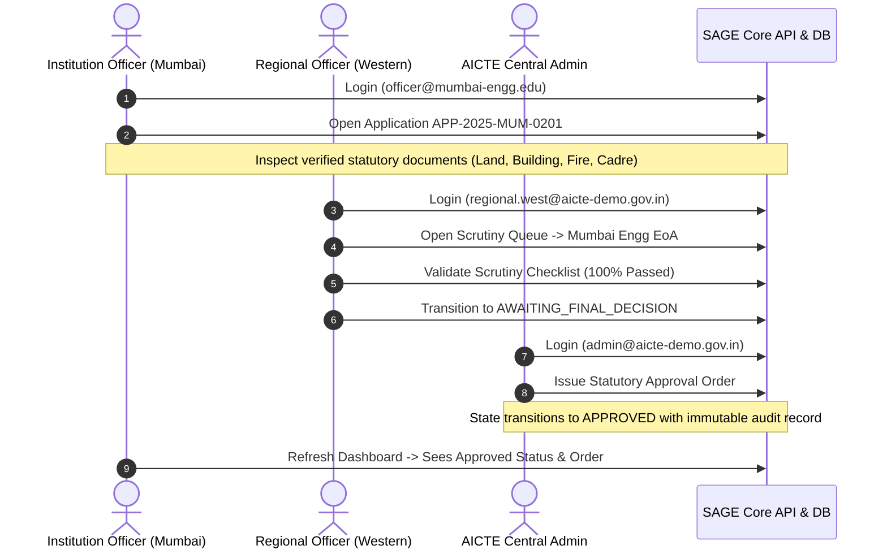
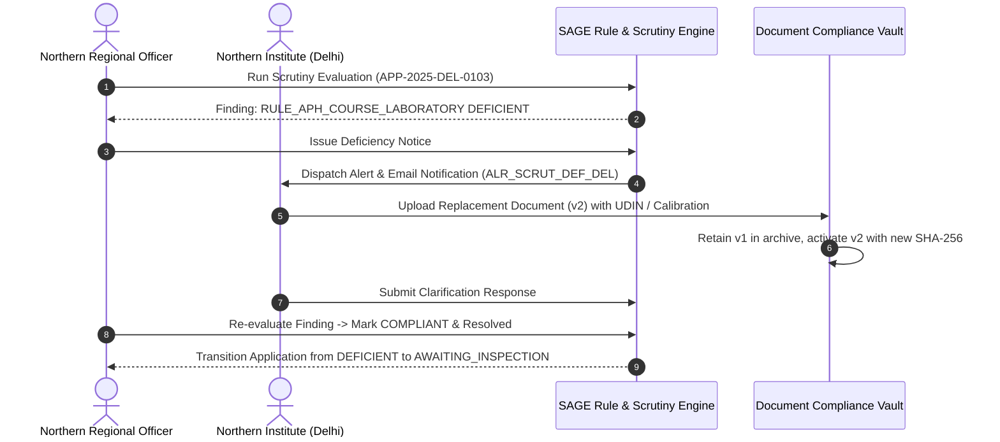
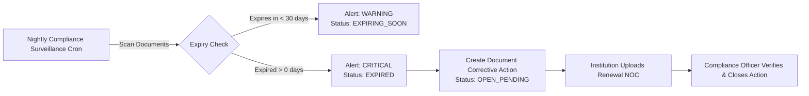
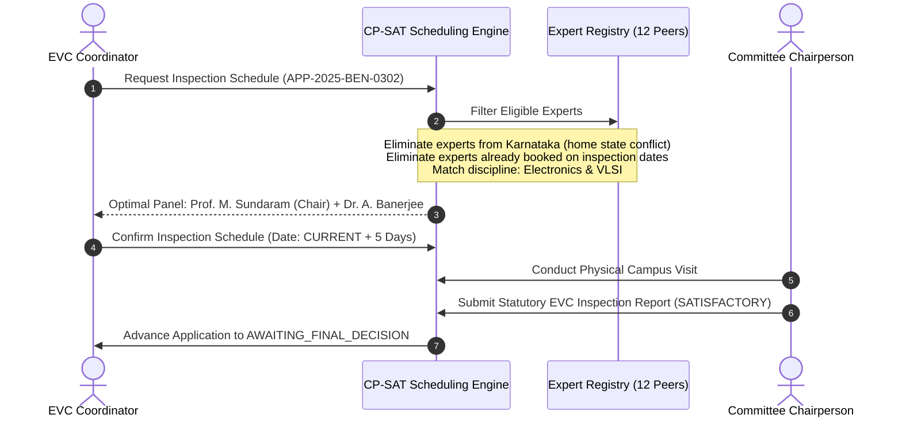
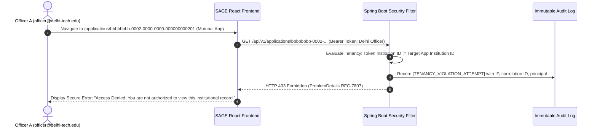

# SAGE — End-to-End Regulatory Demonstration Scenarios

> **Target Audience**: SIH 2026 Evaluation Committee, Technical Evaluators, and Demonstration Presenters.  
> **Key Principle**: Every scenario executes against live PostgreSQL / H2 relational tables and real backend services. No mocked API responses, no hardcoded dashboard numbers, and no disconnected dummy data.

---

## Overview of Seeded Demonstration Scenarios

| Scenario # | Title | Primary Role & Account | Key Application / Target | Workflow Permitted Outcome |
| :---: | :--- | :--- | :--- | :--- |
| **1** | **Successful Extension of Approval (EoA)** | `officer@mumbai-engg.edu` (Inst) & `admin@aicte-demo.gov.in` | `APP-2025-MUM-0201` | `APPROVED` (Clean Scrutiny & Statutory EoA Issued) |
| **2** | **Scrutiny Deficiency & Clarification** | `officer@delhi-tech.edu` & `regional.north@aicte-demo.gov.in` | `APP-2025-DEL-0103` | `DEFICIENT` $\rightarrow$ `CLARIFICATION_SUBMITTED` $\rightarrow$ Scrutiny Cleared |
| **3** | **Continuous Document Expiry & Corrective Action** | `compliance.officer1@aicte-demo.gov.in` & `officer@jaipur-engg.edu` | `APP-2025-JAI-0701` / Fire Safety NOC | `OPEN_PENDING` $\rightarrow$ `SUBMITTED` $\rightarrow$ `VERIFIED_RESOLVED` |
| **4** | **EVC Inspection & CP-SAT Panel Scheduling** | `evc.coord1@aicte-demo.gov.in` & Committee Members | `APP-2025-BEN-0302` / `APP-2025-CHE-0502` | `SCHEDULED` $\rightarrow$ `COMPLETED` (Conflict-free peer panel) |
| **5** | **Zero-Trust Multi-Tenancy & RBAC Enforcement** | `officer@delhi-tech.edu` vs `officer@mumbai-engg.edu` | Direct URL / API Injection | `403 Forbidden` (`TENANCY_VIOLATION_ATTEMPT` Audit) |

---

## Scenario 1 — Fast-Track Extension of Approval (EoA)

### Context & Regulatory Objective
Demonstrate how a compliant institution with unbroken accreditation and complete statutory documentation seamlessly secures Extension of Approval (EoA) under APH 2024-27 Chapter II guidelines without redundant physical inspections.



### Step-by-Step Walkthrough

1. **Log in as Institution Officer**:
   - URL: `http://localhost:5173/login`
   - Email: `officer@mumbai-engg.edu` | Password: `Password123!`
   - **Dashboard Observation**:
     * Current Active Applications count: `3`
     * Status breakdown shows `APP-2025-MUM-0201` as **`APPROVED`**.
     * Notice the Approval Banner and Academic Year `2025-2026`.
2. **Inspect Application Details**:
   - Navigate to `/applications` $\rightarrow$ Click **`APP-2025-MUM-0201`**.
   - Notice the complete workflow state progression timeline:  
     `DRAFT` $\rightarrow$ `SUBMITTED` $\rightarrow$ `UNDER_SCRUTINY` $\rightarrow$ `AWAITING_FINAL_DECISION` $\rightarrow$ **`APPROVED`**.
   - Check the **Documents Tab**: All 4 mandatory compliance documents (Land Lease, Building Stability, Fire Safety, Occupancy) carry status `VERIFIED` with SHA-256 integrity hashes.
3. **Inspect the Audit Record**:
   - Log in as Statutory Auditor (`auditor@aicte-demo.gov.in`).
   - Navigate to `/audit`.
   - Filter by Resource: `APPLICATION:bbbbbbbb-0002-0000-0000-000000000201`.
   - View chronological log of state transitions with principal email, timestamp, and client IP.

---

## Scenario 2 — Scrutiny Deficiency, Notice Issuance & Clarification

### Context & Regulatory Objective
Demonstrate SAGE's rule-based scrutiny engine detecting a deficiency (uncalibrated laboratory hardware testbenches per APH Chapter II Clause 2.4), generating an automated deficiency notice, and allowing the institution to upload a replacement document (v2) with full version history retention.



### Step-by-Step Walkthrough

1. **Log in as Institution Officer (Delhi Tech)**:
   - Email: `officer@delhi-tech.edu` | Password: `Password123!`
   - **Dashboard Observation**:
     * Alert center displays high-priority warning: *"Scrutiny Deficiency Issued: Application APP-2025-DEL-0103 has open scrutiny findings regarding lab testbench calibration."*
2. **Inspect the Deficiency in the Application Desk**:
   - Navigate to `/applications` $\rightarrow$ Select `APP-2025-DEL-0103`.
   - Status badge shows: **`DEFICIENT`**.
   - Open **Scrutiny Findings Tab**:
     * Rule: `RULE_APH_COURSE_LABORATORY`
     * Explanation: *"Testbench equipment utilization report lacks calibration seals per APH Annexure 4."*
     * Status: `DEFICIENT` (Unresolved).
3. **Inspect Document Versioning (v1 vs v2)**:
   - Click on the linked document `ffffffff-0000-0000-0000-000000000007`.
   - View document preview: Notice the watermarked header indicating *Version 1 - Deficient Document*.
4. **Resolution Simulation**:
   - Switch session to Regional Officer (`regional.north@aicte-demo.gov.in`).
   - Navigate to Scrutiny Desk $\rightarrow$ Review clarification.
   - Inspect resolved comparison on Institution 2 (`APP-2025-MUM-0202`), where a previously deficient audited balance sheet was replaced with v2, verified by officer `11111111-1111-1111-1111-200000000003`, and transitioned to `COMPLIANT`.

---

## Scenario 3 — Continuous Document Expiry & Corrective Action Plan

### Context & Regulatory Objective
AICTE compliance monitoring runs continuously in the background, scanning all institutional statutory documents against dynamic regulatory thresholds (e.g., 30-day warning, expired). Demonstrate how an expired fire safety NOC triggers an urgent alert, opens a corrective action plan, and tracks institutional response.



### Step-by-Step Walkthrough

1. **Log in as Compliance Officer**:
   - Email: `compliance.officer1@aicte-demo.gov.in` | Password: `Password123!`
   - **Compliance Surveillance Radar**:
     * Total monitored documents: `73`
     * Expired documents detected: `6` (Bhopal, Vizag, Dehradun, Kolkata, etc.)
     * Expiring soon (within 30 days): `4` (Pune, Chennai, Hyderabad, Gurugram)
2. **Review Open Corrective Actions**:
   - Open `/compliance` $\rightarrow$ **Corrective Actions Tab**.
   - Observe `DCA-2025-0001` (Northern Institute - Expired Fire Safety Certificate):
     * Status: `OPEN_PENDING`
     * Days overdue: `30 days`
     * Action Required: *"Upload renewed Delhi Fire Service Annual Clearance NOC."*
   - Observe `DCA-2025-0003` (Rajasthan College of Engineering):
     * Status: **`RESOLVED`**
     * Verification Note: *"Renewal Fire NOC issued by Rajasthan Fire Service verified. Valid until 2026-10-15."*
3. **Verify Deadline Module Integration**:
   - Navigate to `/deadlines`.
   - Notice statutory deadline `DL_FIRE_RENEWAL_BHO` marked **`OVERDUE`** with automatic email notifications dispatched.

---

## Scenario 4 — EVC Expert Inspection & CP-SAT Scheduling

### Context & Regulatory Objective
Applications for new institutions, new degree programmes, or permanent campus site changes legally mandate an Expert Visit Committee (EVC) physical verification. SAGE features a constraint programming scheduler (Google OR-Tools CP-SAT) that finds conflict-free committee panels based on academic discipline, geographic jurisdiction, and availability.



### Step-by-Step Walkthrough

1. **Log in as EVC Coordinator**:
   - Email: `evc.coord1@aicte-demo.gov.in` | Password: `Password123!`
   - **EVC Operations Dashboard**:
     * Total peer experts: `12`
     * Active inspection visits: `11` across nationwide technical colleges
     * Completed inspections with submitted reports: `2` (`APP-2025-MUM-0201`, `APP-2025-BHO-0602`)
     * Scheduled upcoming inspections: `4` (`APP-2025-DEL-0102`, `APP-2025-BEN-0302`, `APP-2025-CHE-0502`, `APP-2025-DEH-0801`)
2. **Inspect Conflict-Free Committee Allocation**:
   - Open Inspection Schedule for Southern Technical College (`APP-2025-BEN-0302`):
     * Committee Chair: **Prof. Meenakshi Sundaram** (IIT Madras, ECE) — No state conflict in Karnataka.
     * Member: **Dr. Amitav Banerjee** (Jadavpur University, Robotics) — No state conflict.
   - Verify that **Dr. K. S. Radhakrishnan** (Bengaluru resident) was strictly excluded from this panel by the CP-SAT conflict constraint.
3. **View Completed Inspection Report**:
   - Open Inspection for Mumbai Academy (`APP-2025-MUM-0201`):
     * Visit Date: 12 days ago
     * Status: `COMPLETED`
     * Report Outcome: `RECOMMENDED`
     * Remarks: *"Campus infrastructure, faculty cadres, and computing center exceed APH Chapter I norms."*

---

## Scenario 5 — Zero-Trust Multi-Tenancy & URL Tampering Protection

### Context & Regulatory Objective
Verify that SAGE's backend enforces unbreakable multi-tenant authorization boundaries in `AuthoritativeAuthorizationService.java`. An institution officer must never be allowed to access, preview, edit, or tamper with another institution's applications, documents, or alerts, even via direct URL manipulation or crafted API calls.



### Step-by-Step Walkthrough

1. **Log in as Delhi Tech Officer**:
   - Email: `officer@delhi-tech.edu` | Password: `Password123!`
   - Authorized Institution: Northern Institute of Technology (`22222222-2222-2222-2222-222222222222`)
2. **Attempt Cross-Tenant URL Injection**:
   - Paste Mumbai Academy's application ID in the browser URL:  
     `http://localhost:5173/applications/bbbbbbbb-0002-0000-0000-000000000201`
   - **Observed Result**:
     * Frontend immediately intercepts the 403 API response and renders the clean, non-leaking Access Denied card.
     * No sensitive academic, financial, or faculty data is rendered.
3. **Attempt Direct Document Download**:
   - Try fetching a document belonging to Rajasthan College:  
     `GET /api/v1/documents/ffffffff-0000-0000-0000-000000000033/download`
   - Response: `403 Forbidden` with body:
     ```json
     {
       "type": "about:blank",
       "title": "Forbidden",
       "status": 403,
       "detail": "Cross-tenant access violation: Principal 'officer@delhi-tech.edu' is not authorized to access Institution ID: '77777777-7777-7777-7777-222222222207'",
       "instance": "/api/v1/documents/ffffffff-0000-0000-0000-000000000033/download"
     }
     ```
4. **Verify the Security Event in Auditor Logs**:
   - Log in as Statutory Auditor (`auditor@aicte-demo.gov.in`).
   - Navigate to `/audit`.
   - See the security alert: **`TENANCY_VIOLATION_ATTEMPT`** logged with principal `officer@delhi-tech.edu`, resource ID, and network correlation ID.

---

## Evaluation Summary Checklist

| Demonstration Goal | Tested Scenario | Verification Mechanism | Evaluator Pass Criteria |
| :--- | :---: | :--- | :--- |
| **Complete Approval Lifecycle** | 1 | Live Application Desk & State Machine | Unbroken transition to `APPROVED` with valid dates |
| **Deficiency Management** | 2 | Scrutiny Desk & Document Versioning | v1 and v2 preserved, UDIN verification recorded |
| **Continuous Compliance** | 3 | Surveillance Radar & Corrective Plans | Real-time calculation of expiring/expired items |
| **Inspection Scheduling** | 4 | CP-SAT Committee Roster | Conflict-free peer panels with regional exclusion |
| **Security & Tenancy** | 5 | Direct URL Tampering & Audit Log | Immediate 403 rejection and audit trail entry |
