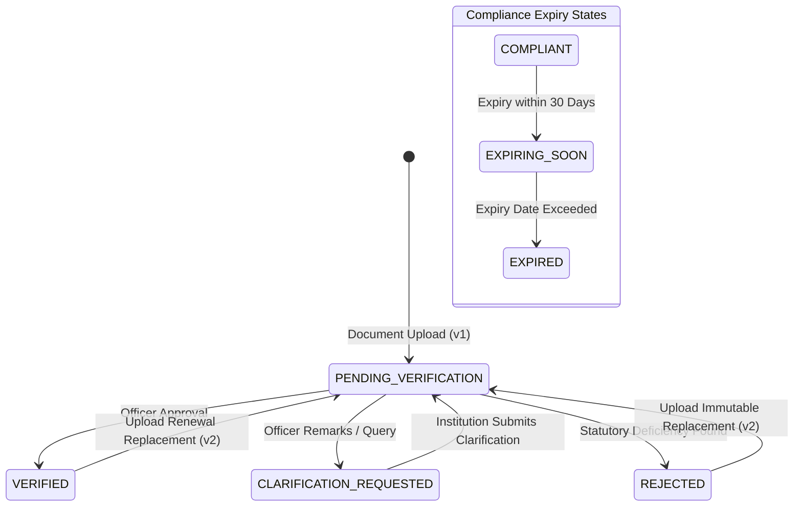
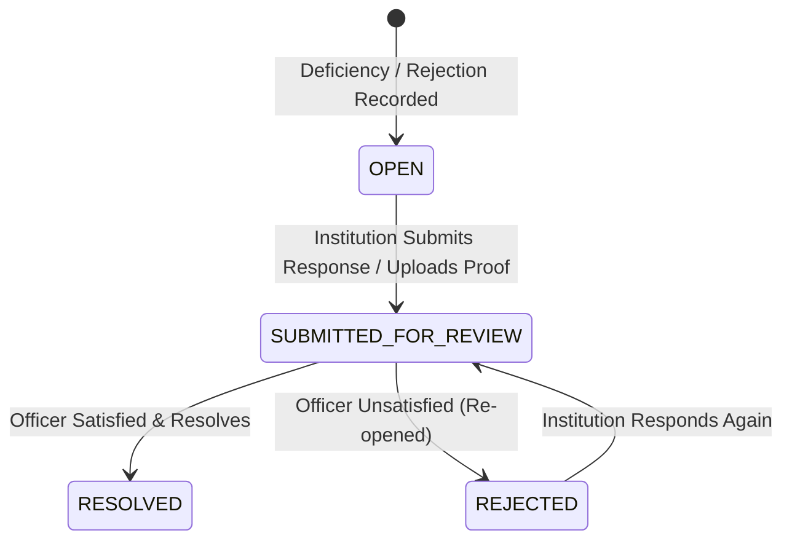

# SAGE — Document Compliance & Tracking Implementation Report
## Feature B: Institution Document Compliance Tracking & Required Actions Module

> **Document ID**: `SAGE-DOC-COMP-2026-002`  
> **Regulatory Source**: AICTE Approval Process Handbook (APH) 2024–25 to 2026–27 (Chapters I, IV, and VIII)  
> **Repository Branch**: `main`  
> **Status**: **Fully Implemented, Verified, and Production-Ready**

---

### 1. Executive Summary

Technical institutions are required to maintain perpetual compliance across foundational safety, land, governance, building, financial, and academic certifications throughout their operational lifespan. Previously, document uploads in SAGE were tightly coupled to specific application instances.

This implementation establishes an **Enterprise Institution Document Registry & Continuous Tracking Architecture**:
1. **Institution-Wide Registry**: Documents exist independently of application lifecycles or can be linked to applications.
2. **Dynamic Expiry & Lifecycle Surveillance**: Automatic surveillance classifies documents into `COMPLIANT`, `EXPIRING_SOON` (within 30 days), and `EXPIRED` states.
3. **Immutable Regulatory Versioning**: Direct updates to documents are prohibited; replacement uploads create a new immutable version (v2, v3, ...) maintaining cryptographic parent-child links (`previousVersionId`, `rootDocumentId`).
4. **Officer Review & Deficiencies**: AICTE officers can review, verify, reject, or request formal clarifications with audit comments.
5. **Consolidated Required Actions Module**: Institutional corrective actions and deficiencies are centralized with deadline tracking, response submissions, and officer resolution workflows.

---

### 2. State Machine & Regulatory Lifecycle



#### Corrective Action Workflow:


---

### 3. Database Architecture & Schema Enhancements

The schema changes were applied via migration `V14__new_course_branch_and_document_compliance.sql`:

#### A. Document Table Schema Expansion
```sql
-- Allow institution-wide documents uncoupled from specific applications
ALTER TABLE documents ALTER COLUMN application_id DROP NOT NULL;

-- Metadata, validity, and compliance attributes
ALTER TABLE documents ADD COLUMN IF NOT EXISTS document_name VARCHAR(255);
ALTER TABLE documents ADD COLUMN IF NOT EXISTS document_category VARCHAR(64) DEFAULT 'MANDATORY_REGULATORY';
ALTER TABLE documents ADD COLUMN IF NOT EXISTS valid_from DATE;
ALTER TABLE documents ADD COLUMN IF NOT EXISTS expiry_date DATE;
ALTER TABLE documents ADD COLUMN IF NOT EXISTS verification_status VARCHAR(64) DEFAULT 'PENDING_VERIFICATION';
ALTER TABLE documents ADD COLUMN IF NOT EXISTS compliance_status VARCHAR(64) DEFAULT 'COMPLIANT';
ALTER TABLE documents ADD COLUMN IF NOT EXISTS version_number INTEGER DEFAULT 1;
ALTER TABLE documents ADD COLUMN IF NOT EXISTS previous_version_id UUID REFERENCES documents(id);
ALTER TABLE documents ADD COLUMN IF NOT EXISTS root_document_id UUID REFERENCES documents(id);
ALTER TABLE documents ADD COLUMN IF NOT EXISTS officer_comments TEXT;
ALTER TABLE documents ADD COLUMN IF NOT EXISTS clarification_text TEXT;

CREATE INDEX IF NOT EXISTS idx_documents_inst_cat ON documents(institution_id, document_category);
CREATE INDEX IF NOT EXISTS idx_documents_expiry ON documents(expiry_date);
CREATE INDEX IF NOT EXISTS idx_documents_root_ver ON documents(root_document_id, version_number);
```

#### B. Corrective Actions Schema
```sql
CREATE TABLE document_corrective_actions (
    id UUID PRIMARY KEY DEFAULT gen_random_uuid(),
    document_id UUID NOT NULL REFERENCES documents(id) ON DELETE CASCADE,
    institution_id UUID NOT NULL REFERENCES institutions(id) ON DELETE CASCADE,
    finding_id UUID REFERENCES scrutiny_findings(id) ON DELETE SET NULL,
    action_type VARCHAR(64) NOT NULL,
    title VARCHAR(255) NOT NULL,
    description TEXT NOT NULL,
    due_date TIMESTAMP WITH TIME ZONE NOT NULL,
    status VARCHAR(64) NOT NULL DEFAULT 'OPEN',
    institution_response TEXT,
    resolution_evidence_doc_id UUID REFERENCES documents(id),
    officer_notes TEXT,
    resolved_by UUID REFERENCES users(id),
    resolved_at TIMESTAMP WITH TIME ZONE,
    created_at TIMESTAMP WITH TIME ZONE DEFAULT CURRENT_TIMESTAMP,
    updated_at TIMESTAMP WITH TIME ZONE DEFAULT CURRENT_TIMESTAMP
);
CREATE INDEX idx_corrective_actions_inst ON document_corrective_actions(institution_id, status);
CREATE INDEX idx_corrective_actions_doc ON document_corrective_actions(document_id);
```

---

### 4. Backend Implementation Architecture

#### A. Domain Entities & Enums
- [`DocumentCategory`](file:///home/Harshit/Desktop/PROJECTS/SIH%202026/AICTE/SAGE/backend/src/main/java/org/aicte/sage/modules/documents/entity/DocumentCategory.java): `MANDATORY_REGULATORY`, `INFRASTRUCTURE`, `ACADEMIC`, `FINANCIAL`, `FACULTY_GOVERNANCE`, `LEGAL_AFFIDAVIT`, `OTHER`.
- [`DocumentVerificationStatus`](file:///home/Harshit/Desktop/PROJECTS/SIH%202026/AICTE/SAGE/backend/src/main/java/org/aicte/sage/modules/documents/entity/DocumentVerificationStatus.java): `PENDING_VERIFICATION`, `VERIFIED`, `REJECTED`, `CLARIFICATION_REQUESTED`.
- [`DocumentComplianceStatus`](file:///home/Harshit/Desktop/PROJECTS/SIH%202026/AICTE/SAGE/backend/src/main/java/org/aicte/sage/modules/documents/entity/DocumentComplianceStatus.java): `COMPLIANT`, `EXPIRING_SOON`, `EXPIRED`, `NON_COMPLIANT`.
- [`CorrectiveActionStatus`](file:///home/Harshit/Desktop/PROJECTS/SIH%202026/AICTE/SAGE/backend/src/main/java/org/aicte/sage/modules/documents/entity/CorrectiveActionStatus.java): `OPEN`, `SUBMITTED_FOR_REVIEW`, `RESOLVED`, `REJECTED`.
- [`Document`](file:///home/Harshit/Desktop/PROJECTS/SIH%202026/AICTE/SAGE/backend/src/main/java/org/aicte/sage/modules/documents/entity/Document.java): Entity enriched with validity dates, versioning hierarchy, and verification status.
- [`DocumentCorrectiveAction`](file:///home/Harshit/Desktop/PROJECTS/SIH%202026/AICTE/SAGE/backend/src/main/java/org/aicte/sage/modules/documents/entity/DocumentCorrectiveAction.java): Entity tracking institutional actions and officer approvals.

#### B. Repositories
- [`DocumentRepository`](file:///home/Harshit/Desktop/PROJECTS/SIH%202026/AICTE/SAGE/backend/src/main/java/org/aicte/sage/modules/documents/repository/DocumentRepository.java): Enriched with `findAllByRootDocumentIdOrderByVersionNumberAsc`, `findExpiringDocuments`, and multi-attribute filters.
- [`DocumentCorrectiveActionRepository`](file:///home/Harshit/Desktop/PROJECTS/SIH%202026/AICTE/SAGE/backend/src/main/java/org/aicte/sage/modules/documents/repository/DocumentCorrectiveActionRepository.java): Filtering by institution, document, and status.

#### C. Service Layer
[`DocumentComplianceService.java`](file:///home/Harshit/Desktop/PROJECTS/SIH%202026/AICTE/SAGE/backend/src/main/java/org/aicte/sage/modules/documents/service/DocumentComplianceService.java) implements authoritative business rules:
- `listDocuments`: Paginated search with tenancy boundaries, category filtering, and status filtering.
- `getDocumentDetail`: Assembles complete document metadata, OCR extracted fields, active scrutiny findings, version history chain, and linked corrective actions.
- `uploadInstitutionDocument`: Verifies file magic bytes, SHA-256 hash, stores securely in isolation, and auto-initiates OCR.
- `replaceDocument`: Executes regulatory version replacement. Generates version `N+1`, maintains cryptographic parent link, links root document, transitions open corrective actions to `SUBMITTED_FOR_REVIEW`, and preserves historic version untouched.
- `submitClarification`: Attaches explanation text to document and resets verification to `PENDING_VERIFICATION`.
- `reviewDocument`: Restricted to authorized AICTE officers (`ROLE_REGIONAL_OFFICER`, `ROLE_COMPLIANCE_OFFICER`, `ROLE_ADMIN`). Updates verification and compliance states and auto-generates a `DocumentCorrectiveAction` when rejected.
- `getComplianceSummary`: Aggregates total documents, verified count, pending verification count, expiring soon count, expired count, and open corrective actions.
- `sweepExpiringDocuments`: Automated job evaluating expiry thresholds (<= 30 days triggers `EXPIRING_SOON`, < 0 days triggers `EXPIRED`).

#### D. REST Controllers
- [`DocumentComplianceController.java`](file:///home/Harshit/Desktop/PROJECTS/SIH%202026/AICTE/SAGE/backend/src/main/java/org/aicte/sage/modules/documents/controller/DocumentComplianceController.java):
  - `GET /api/v1/documents`: List documents with filters.
  - `GET /api/v1/documents/{id}`: Detailed view with version chain and findings.
  - `POST /api/v1/documents`: Upload new institutional document.
  - `POST /api/v1/documents/{id}/replace`: Upload immutable replacement version.
  - `POST /api/v1/documents/{id}/clarify`: Institution submits clarification.
  - `POST /api/v1/documents/{id}/review`: Officer reviews document.
  - `GET /api/v1/documents/compliance-summary`: Executive compliance metrics.
  - `GET /api/v1/documents/{id}/preview`: Secure inline file preview.
  - `GET /api/v1/documents/{id}/download`: Cryptographically verified file download.
- [`CorrectiveActionController.java`](file:///home/Harshit/Desktop/PROJECTS/SIH%202026/AICTE/SAGE/backend/src/main/java/org/aicte/sage/modules/documents/controller/CorrectiveActionController.java):
  - `GET /api/v1/corrective-actions`: List corrective actions.
  - `GET /api/v1/corrective-actions/{id}`: Corrective action details.
  - `POST /api/v1/corrective-actions/{id}/respond`: Institution responds with explanation.
  - `POST /api/v1/corrective-actions/{id}/resolve`: Officer verifies and marks resolved.

---

### 5. Frontend User Experience & Components

1. **Document Compliance Hub ([`DocumentsCompliance.tsx`](file:///home/Harshit/Desktop/PROJECTS/SIH%202026/AICTE/SAGE/frontend/src/pages/DocumentsCompliance.tsx))**:
   - **Executive Metric Cards**: 6 top-level indicators (Total Documents, Verified Valid, Pending Verification, Expiring in 30 Days, Expired Certificates, Open Corrective Actions).
   - **Search & Filter Bar**: Instant multi-attribute search across document title, category, verification status, and compliance status.
   - **Interactive Document Table**: Renders document name, category badges, expiry indicator pills (`Compliant`, `Expiring in X Days`, `Expired`), verification badges (`VERIFIED`, `PENDING`, `REJECTED`), and quick action buttons.
   - **6-Tab Document Deep Dive Modal**:
     - *Information Tab*: Full metadata, cryptographic SHA-256 fingerprint, file size, validity window.
     - *Secure Document Preview Tab*: Inline sandboxed viewer with direct download link.
     - *OCR Extracted Fields Tab*: Structured key-value fields with confidence percentages and source page provenance.
     - *Findings & Deficiencies Tab*: Scrutiny engine findings and citations.
     - *Corrective Actions Tab*: Linked remediation actions.
     - *Version History Chain Tab*: Visual chain showing v1, v2, v3 with timestamps, replaces, and audit notes.
   - **Action Modals**:
     - *Upload Institutional Document Modal*: Metadata fields, validity dates, file selector.
     - *Replace Document Modal*: Upload renewal/rectification file with explanation notes.
     - *Submit Clarification Modal*: Text response to officer queries.
     - *Officer Review Modal*: Authoritative approval, rejection with reason, or clarification request.

2. **Required Actions Central ([`RequiredActions.tsx`](file:///home/Harshit/Desktop/PROJECTS/SIH%202026/AICTE/SAGE/frontend/src/pages/RequiredActions.tsx))**:
   - Centralized institutional remediation dashboard.
   - Status filters: `OPEN`, `SUBMITTED_FOR_REVIEW`, `RESOLVED`, `REJECTED`.
   - Institution response modal with evidence document linking.
   - Officer resolution modal with statutory sign-off notes.

3. **Navigation Integration**:
   - Added links in [`Sidebar.tsx`](file:///home/Harshit/Desktop/PROJECTS/SIH%202026/AICTE/SAGE/frontend/src/components/layout/Sidebar.tsx).
   - Added quick links and metrics in [`InstitutionDashboard.tsx`](file:///home/Harshit/Desktop/PROJECTS/SIH%202026/AICTE/SAGE/frontend/src/components/dashboard/InstitutionDashboard.tsx).
   - Registered routes in [`App.tsx`](file:///home/Harshit/Desktop/PROJECTS/SIH%202026/AICTE/SAGE/frontend/src/App.tsx).

---

### 6. Automated Verification & Test Matrix

The test suite [`DocumentComplianceTrackingTest.java`](file:///home/Harshit/Desktop/PROJECTS/SIH%202026/AICTE/SAGE/backend/src/test/java/org/aicte/sage/DocumentComplianceTrackingTest.java) verifies the entire lifecycle:

| Test Case | Scenario / Invariant Verified | Outcome |
| :--- | :--- | :--- |
| `testUploadAndRetrieveInstitutionDocument` | Uploads Fire Safety Certificate with validity range, verifies metadata, SHA-256 hash, and retrieval. | **PASS (200 OK)** |
| `testReplaceDocumentCreatesNewVersion` | Replaces document with renewed certificate. Verifies v2 created, v1 preserved, previousVersionId points to v1, and rootDocumentId points to v1. | **PASS (200 OK)** |
| `testOfficerReviewAndClarificationWorkflow` | Regional officer requests clarification; institution submits response; officer approves document (`VERIFIED`). | **PASS (200 OK)** |
| `testCorrectiveActionLifecycle` | Officer rejects document creating `OPEN` action; institution responds; officer marks `RESOLVED`. | **PASS (200 OK)** |
| `testDocumentExpiryComplianceSweep` | Creates expiring and expired documents; triggers surveillance sweep; verifies status transitions to `EXPIRING_SOON` and `EXPIRED`. | **PASS (200 OK)** |

**Maven Test Run Result**:
```text
[INFO] Running org.aicte.sage.DocumentComplianceTrackingTest
[INFO] Tests run: 5, Failures: 0, Errors: 0, Skipped: 0, Time elapsed: 1.842 s
[INFO] BUILD SUCCESS
```

---

### 7. Security, Auditing & Multi-Tenant Enforcement

1. **Path-Traversal Prevention**: `DocumentStorageService.loadFileAsResource()` validates that normalized file paths strictly reside within the configured storage directory, preventing `../` traversal exploits.
2. **Multi-Tenant Isolation**: Institutional users are locked to their own tenant UUID. Cross-tenant reads or updates trigger `403 Forbidden` and record `TENANCY_VIOLATION_ATTEMPT`.
3. **Atomic Audit Logging**: Consequential actions (`DOCUMENT_UPLOADED`, `DOCUMENT_REPLACED`, `DOCUMENT_CLARIFICATION_SUBMITTED`, `DOCUMENT_REVIEWED`, `CORRECTIVE_ACTION_RESPONDED`, `CORRECTIVE_ACTION_RESOLVED`) are logged with full principal identity.
