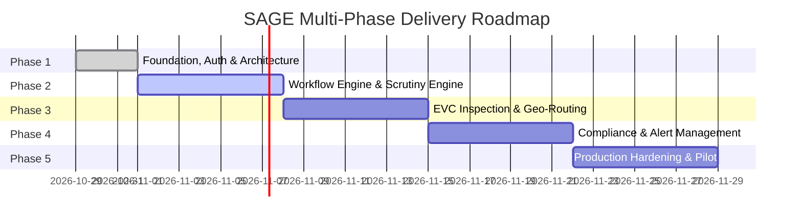

# SAGE Implementation Roadmap — Multi-Phase Delivery Plan

Aligned with **SIH 2026 Problem Statement 26262**:
*“Integrated AICTE Approval Workflow Automation, Compliance Monitoring and Alert Management System.”*

---

## Phase Breakdown and Milestones

### Phase 1: Secure Foundation and Architecture (CURRENT)
- **Scope**:
  - Multi-service monorepo structure (Spring Boot 3.4, Python 3.14 FastAPI, React Vite TS).
  - Environment inspection and prerequisite governance.
  - Multi-tenant relational schema design with versioned Flyway migrations.
  - Zero-Trust, resource-level RBAC authorization engine (cross-institution isolation).
  - Fail-closed security architecture, JWT authentication with safe local fallback.
  - Cross-cutting correlation tracing (`X-Correlation-ID`) and RFC 7807 problem details.
  - Development system health monitoring frontend & service health/readiness probes.
  - Comprehensive unit, slice, and integration tests across services.
- **Definition of Done**:
  - All unit/slice tests pass cleanly.
  - Both Spring Boot and FastAPI health endpoints respond `200 OK`.
  - Tenancy isolation test verifies that unauthorized institution access returns HTTP 403.
  - Ready for Phase 2 workflow extensions without architectural refactoring.

### Phase 2: Core Approval Workflow & Automated Scrutiny
- **Scope**:
  - AICTE Approval Application submission engine (New Institute, Extension of Approval - EoA, Course Addition, Intake Variation).
  - Multi-stage approval state machine (Draft -> Submitted -> Scrutiny -> EVC -> SAC -> Approved/Rejected).
  - Python Document Intelligence microservice: automated parsing and verification of Land Documents, Fire Safety Certificates, Building Completion, and Affidavits.
  - Rule-based deficiency calculator scoring institutional compliance against AICTE Approval Process Handbook (APH) norms.

### Phase 3: Expert Visit Committee (EVC) & Geographic Optimization
- **Scope**:
  - Virtual & Physical EVC panel allocation algorithm (conflict-of-interest detection avoiding alumni/faculty overlap).
  - Geospatial clustering and route optimization in Python.
  - Mobile-responsive inspection checklist with tamper-evident geo-fenced photo uploads.
  - Real-time committee scoring aggregation.

### Phase 4: Continuous Compliance & Proactive Alert Engine
- **Scope**:
  - Faculty-student ratio (FSR) and cadre ratio continuous monitoring.
  - Grievance redressal and anti-ragging compliance tracking.
  - Automated deadline tracking with multi-stage alert escalation (T-30, T-15, T-7 days, T-24h).
  - Multi-channel notification pipeline (SMS, Email, Push Notifications via asynchronous workers).

### Phase 5: Production Hardening, Scale & Security Audit
- **Scope**:
  - Penetration testing, OWASP Top 10 remediation, rate limiting, and DDoS protections.
  - Cloud deployment topology (AWS/MeghRaj NIC Cloud) with Kubernetes Helm charts.
  - Prometheus/Grafana metrics monitoring and centralized OpenTelemetry tracing.
  - Pilot onboarding with selected regional AICTE offices.
