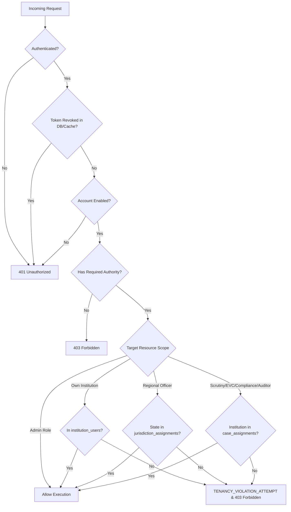
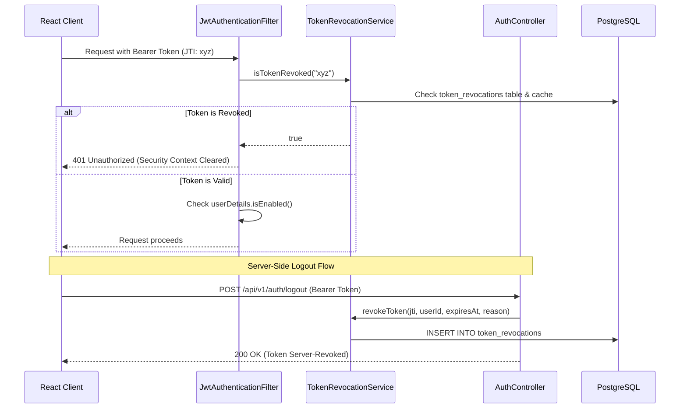

# SAGE Security Model & Tenancy Isolation Strategy

## 1. Core Principles

The SAGE platform adheres to a **Zero-Trust, Multi-Tenant Isolation** architecture designed for national regulatory operations:
1. **Never Trust Client Claims**: Authorization decisions are computed strictly on the backend using the verified security context and relational ownership links.
2. **Fail Closed**: Any unauthenticated request, malformed token, unmapped tenant, or missing permission defaults to HTTP `401 Unauthorized` or `403 Forbidden`.
3. **Multi-Tenancy Resource Isolation**: Institution officers are bound strictly to their designated Institution IDs. Any attempt to read, update, or approve another institution's assets triggers an immediate security violation and records an immutable audit log.
4. **No Static or Hardcoded Secrets**: Secrets are sourced dynamically from environment variables. Local development provides safe defaults clearly marked for non-production environments.

---

## 2. APH Handbook-Aligned Role, Committee & Authority Architecture

SAGE strictly distinguishes between **Statutory Bodies & Committees** defined by the AICTE Act 1987 & Approval Process Handbook 2024-27 (Annexure 16), **Operational Roles** created for portal workflows, and **Technical Service Identities** used for automation.

### 2.1 Statutory Bodies & Committees (APH Annexure 16 / Clauses 16.1 – 16.8)
| Committee / Body | APH Clause & Printed Page | Composition & Quorum Requirements | Statutory Responsibilities |
|---|---|---|---|
| **The Council** | Clause 16.1 & 16.8 (p. 177-178) | Statutory apex body per Section 10 of AICTE Act, 1987 | Final policy, ratification, and appellate determination |
| **Executive Committee (EC)** | Clause 16.2 & 16.8 (p. 177-178) | Chairman, Vice-Chairman, Central Govt Secretary, Regional Chairs, Boards of Studies, Finance Rep, State Reps, Experts, Member Secretary. Quorum: 1/3 | Functions assigned by Council per Section 10; approval decisions |
| **Scrutiny Committee (Chapter I)** | Clause 16.3 & 16.8 (p. 177-178) | Prof/Assoc Prof (IIT/IIM/NIT/Govt) + Bar Council Advocate + CoA Architect or Civil Structural Prof | Document verification for **Setting up New Institutions** |
| **Scrutiny Committee (Chapter II)** | Clause 16.4 & 16.8 (p. 177-178) | Two Professors / Associate Professors of IIT / IIM / NIT / Govt Institutions | Document verification for **Existing Institutions** (EoA, Intake variation) |
| **Re-Scrutiny Committee** | Clauses 16.3, 16.4 (p. 177-178) | Same composition as Scrutiny | Re-examination strictly limited to the specific deficiencies originally recorded |
| **Expert Visit Committee (EVC)** | Clause 16.5 & 16.8 (p. 177-178) | Academician Professor from EC-approved panel + Assoc Prof/Industry Expert (5+ yrs) + CoA/CPWD/Civil Architect | Physical/virtual inspection of infrastructure and faculty availability |
| **Standing Hearing Committee (SHC)** | Clause 16.6 & 16.8 (p. 177-178) | Retired High Court Judge / Eminent Vice-Chancellor (Chair) + Technical Prof/Assoc Prof + Revenue Officer/CoA Architect | Compliance assessment of EVC deficiencies and Show Cause Notices |
| **Standing Appellate Committee (SAC)** | Clause 16.6 & 16.8 (p. 177-178) | Same composition as SHC (different members from hearing) | Quasi-judicial review of appeals against SHC recommendations |
| **Standing Complaint Scrutiny Committee (SCSC)** | Clause 16.7 & 16.8 (p. 178) | Retired High Court Judge (Chair) + 2 Technical Assoc Profs + CoA Architect + DTE/Registrar. Quorum: Chair + 2 | Processing and hearing of complaints against institutions |

> [!IMPORTANT]
> **No Statutory Membership by Inference**: Holding an application role (`ROLE_COMMITTEE_MEMBER`, `ROLE_SCRUTINY_OFFICER`, etc.) **never** confers statutory authority. Authorization strictly verifies active, non-expired records in the `committee_appointments` table matching the specific committee type.

### 2.2 Operational Roles
| Role Code | Tenancy Scope | Authorized Governance Function |
|---|---|---|
| `ROLE_AICTE_ADMIN` | Global (All Tenants) | Central regulatory administration, role management, institution lifecycle, global audit inspection |
| `ROLE_REGIONAL_OFFICER` | Regional Jurisdiction | Jurisdiction-scoped institution monitoring and workflow actions based on `jurisdiction_assignments` |
| `ROLE_SCRUTINY_OFFICER` | Case-Assigned | Scrutiny review restricted to explicitly assigned applications (`case_assignments`) |
| `ROLE_EVC_COORDINATOR` | Case-Assigned | Inspection panel coordination for designated colleges (`case_assignments`) |
| `ROLE_EVC_MEMBER` | Case-Assigned | Inspection reporting for designated site visits (`case_assignments`) |
| `ROLE_COMMITTEE_MEMBER` | Committee-Appointed | Participation in hearings/appeals validated against `committee_appointments` |
| `ROLE_COMPLIANCE_OFFICER` | Case-Assigned | Continuous compliance monitoring restricted to active case assignments |
| `ROLE_AUDITOR` | Case-Assigned / Scoped | Regulatory audit inspection restricted to assigned cases or authorized regional scope |
| `ROLE_INSTITUTION_OFFICER` | Single Tenant | Management and application submission strictly for own college (`institution_users`) |

### 2.3 Technical Service Identities
| Identity | Authentication Scheme | Purpose |
|---|---|---|
| `SERVICE_AUTOMATION_ENGINE` | `X-Internal-Service-Token` (min 32 chars) | Automated document OCR, compliance telemetry ingestion, and async processing |

---

## 3. Authoritative Multi-Tenant Authorization Policy

Authorization is enforced at both controller and service/domain boundaries by [AuthoritativeAuthorizationService.java](file:///home/Harshit/Desktop/PROJECTS/SIH%202026/AICTE/SAGE/backend/src/main/java/org/aicte/sage/common/security/AuthoritativeAuthorizationService.java):

### Elimination of Blanket Cross-Institution Access
Officers no longer possess unrestricted, role-based read/update access across colleges. Access to any institution record requires:
1. Global administrative role (`ROLE_AICTE_ADMIN`), OR
2. Direct institutional affiliation in `institution_users`, OR
3. Active regional jurisdiction covering the institution's state in `jurisdiction_assignments`, OR
4. Explicit active case assignment in `case_assignments`.

Any violation raises `TenantIsolationException` and logs a `TENANCY_VIOLATION_ATTEMPT` audit record with client IP and correlation ID.

---

## 4. Authentication Lifecycle & Server-Side Token Revocation

1. **Server-Side Token Revocation**: Each JWT contains a unique `jti` (UUID). On logout, the token is recorded in `token_revocations` and the in-memory cache until its natural expiration.
2. **Account Deactivation Protection**: Even with a valid, non-expired JWT, deactivated/suspended users are immediately rejected (401 Unauthorized).
3. **Operational Error Isolation**: Database connectivity issues during authentication throw `DataAccessException` rather than swallowing the error as a false credential failure.

---

## 5. Reliable Regulatory Audit (Transactional Outbox & Classification)

Audit events are strictly classified into two categories:

### 5.1 Mandatory Regulatory Events (`AuditClassification.MANDATORY`)
- **Applies to**: Consequential state changes (`INSTITUTION_CREATED`, `INSTITUTION_STATUS_CHANGED`, `INSTITUTION_USER_AFFILIATED`, `INSTITUTION_USER_REMOVED`, `USER_CREATED`, `USER_STATUS_CHANGED`, `ROLE_ASSIGNED`).
- **Transactional Guarantee**: Executed with `Propagation.MANDATORY` within the primary caller transaction.
- **Fail-Closed Policy**: If audit persistence fails, `AuditPersistenceException` is thrown, rolling back the business transaction. State changes can **never** commit without an audit entry.

### 5.2 Best-Effort Events (`AuditClassification.BEST_EFFORT`)
- **Applies to**: Operational logs (`AUTH_LOGIN_SUCCESS`, `AUTH_LOGIN_FAILURE`, `AUTH_LOGOUT`, `TENANCY_VIOLATION_ATTEMPT`, `PRIVILEGE_ESCALATION_BLOCKED`).
- **Transactional Guarantee**: Executed with `Propagation.REQUIRES_NEW`. Failures are logged without interrupting non-state-changing operations.

---

## 6. Privilege Escalation Defenses & Input Safety

1. **Role Assignment Privilege Boundary**: Non-administrators cannot assign `ROLE_AICTE_ADMIN`. Attempting to do so raises `AccessDeniedException` and records `PRIVILEGE_ESCALATION_BLOCKED`.
2. **Strict Institution Reference Validation**: Associating a user with an unknown institution ID throws `ResourceNotFoundException` (HTTP 404 Problem Details) rather than silently omitting the affiliation.
3. **Administrative Self-Lockout Prevention**: An administrator cannot suspend their own active session account.
4. **Pagination & Query Abuse Defense**: `PaginationUtils` strictly enforces:
   - Non-negative page index (`page >= 0`).
   - Page size boundaries (`1 <= size <= 100`).
   - Strict allowlist validation of sort fields (`ALLOWED_SORT_FIELDS`).
   - Allowed sort directions (`asc` or `desc`).
