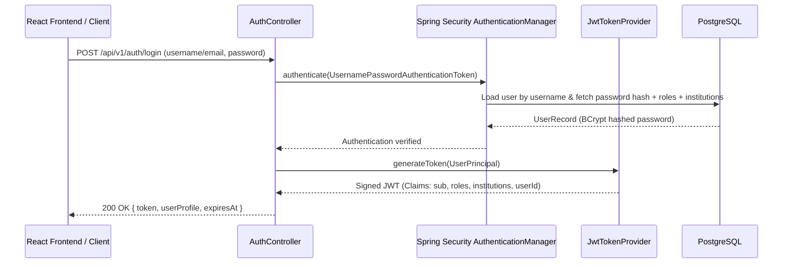

# SAGE Security Model & Tenancy Isolation Strategy

## 1. Core Principles

The SAGE platform adheres to a **Zero-Trust, Multi-Tenant Isolation** architecture designed for national regulatory operations:
1. **Never Trust Client Claims**: Authorization decisions are computed strictly on the backend using the verified security context and relational ownership links.
2. **Fail Closed**: Any unauthenticated request, malformed token, unmapped tenant, or missing permission defaults to HTTP `401 Unauthorized` or `403 Forbidden`.
3. **Multi-Tenancy Resource Isolation**: Institution officers are bound strictly to their designated Institution IDs. Any attempt to read, update, or approve another institution's assets triggers an immediate security violation and records an immutable audit log.
4. **No Static or Hardcoded Secrets**: Secrets are sourced dynamically from environment variables. Local development provides safe defaults clearly marked for non-production environments.

---

## 2. Role-Based Access Control (RBAC) & Permission Matrix

SAGE defines five system roles with clear separation of duties:

| Role Code | Role Name | Scope | Key Permissions |
|-----------|-----------|-------|-----------------|
| `ROLE_AICTE_ADMIN` | AICTE Central Administrator | Global | System administration, role assignment, policy configuration, complete audit log inspection. |
| `ROLE_REGIONAL_OFFICER` | AICTE Regional Officer | Regional / Multi-Institution | Application review, regional institution oversight, scrutiny committee dispatch. |
| `ROLE_SCRUTINY_OFFICER` | Scrutiny Officer / Expert | Assigned Application | Scrutiny checklist evaluation, deficiency logging, verification of institutional claims. |
| `ROLE_EVC_MEMBER` | Expert Visit Committee Member | Assigned Visit | Physical/virtual inspection checklist submission, geo-tagged photo verification. |
| `ROLE_INSTITUTION_OFFICER` | Institution Authorized Signatory | Scoped to Specific Institution(s) | Institution profile submission, document upload, compliance self-disclosure, fee acknowledgement. |

---

## 3. Resource-Level Tenancy Authorization (Cross-Institution Protection)

### The Problem
Traditional RBAC checks whether a user has `ROLE_INSTITUTION_OFFICER`. However, an institution officer from "College A" must be prevented from reading applications or compliance reports belonging to "College B" (Broken Object Level Authorization - BOLA / IDOR).

### SAGE Solution: Two-Layer Authorization
1. **Layer 1: URL/Method Role Check**:
   Spring Security checks `@PreAuthorize("hasAnyRole('AICTE_ADMIN', 'REGIONAL_OFFICER', 'INSTITUTION_OFFICER')")`.
2. **Layer 2: Domain-Level Tenancy Evaluator**:
   `TenancyAuthorizationEvaluator` inspects the target resource's `institution_id`.
   - If the caller has `ROLE_AICTE_ADMIN`, access is granted globally.
   - If the caller has `ROLE_INSTITUTION_OFFICER`, the evaluator queries `institution_users` table to verify active membership between `user_id` and `target_institution_id`.
   - If no valid active link exists, a `TenantIsolationException` is thrown:
     - Returns HTTP `403 Forbidden` with a standardized Problem Details payload.
     - Automatically emits an `AUDIT_SECURITY_VIOLATION` event to the `audit_events` table recording the caller identity, client IP, target institution ID, and correlation ID.

---

## 4. Authentication Architecture

### Password Hashing
- Algorithm: **BCrypt** with configurable salt rounds (default: `12` rounds in production, `10` in local testing for speed).
- No plaintext passwords are ever persisted or logged.

### JWT Security Specs
- Signature Algorithm: **HMAC-SHA256** (`HS256`) or `RS256` for external IdP.
- Token Lifetime: Configurable (default: 8 hours).
- Payload claims:
  - `sub`: User ID (UUID)
  - `username`: Account identifier
  - `roles`: Set of assigned authority strings (`["ROLE_INSTITUTION_OFFICER"]`)
  - `institutions`: Set of authorized Institution IDs (`["inst-uuid-1"]`)
  - `jti`: Unique token identifier for replay prevention.

---

## 5. Service-to-Service Authentication (Backend ↔ Automation)

Human identities are strictly segregated from automated service accounts:
1. When the Python Automation service communicates with Spring Boot endpoints, it provides an `X-Internal-Service-Token` HTTP header.
2. The Spring Boot backend validates this token against `INTERNAL_SERVICE_TOKEN` configured in environment variables.
3. Automated requests operate under the synthetic principal `SERVICE_AUTOMATION_ENGINE` with restricted machine-to-machine capabilities.

---

## 6. Audit Logging & Non-Repudiation

Every consequential regulatory action produces an immutable row in the `audit_events` table:
- **Event Types**:
  - `AUTH_LOGIN_SUCCESS`, `AUTH_LOGIN_FAILURE`
  - `TENANCY_VIOLATION_ATTEMPT`
  - `INSTITUTION_CREATED`, `INSTITUTION_UPDATED`
  - `DOCUMENT_UPLOADED`, `DOCUMENT_VERIFIED`
  - `SCRUTINY_DECISION_RECORDED`
- **Fields Captured**: `id`, `event_type`, `principal`, `institution_id`, `resource_type`, `resource_id`, `action`, `client_ip`, `correlation_id`, `details` (JSONB), and `created_at`.
