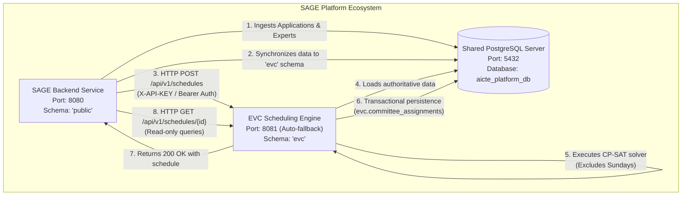
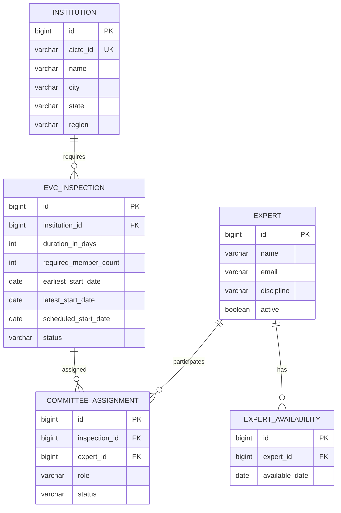

# EVC Scheduling Engine — SAGE Integration Technical Handoff Guide

> **Document Version:** 1.0.0  
> **Target Audience:** SAGE Backend Engineers, Systems Integrators, and AI Coding Agents  
> **Base Package:** `in.gov.aicte.evc`  
> **Target Repository:** Standalone EVC Scheduling Engine (`evc-scheduling-engine`)  
> **Client Platform:** SAGE Platform (`aicte-compliance-platform` / `SIH2`)  

---

## Table of Contents
1. [Executive Summary & Purpose](#1-executive-summary--purpose)
2. [System Architecture & Interaction Model](#2-system-architecture--interaction-model)
3. [Technology Stack & Runtime Specifications](#3-technology-stack--runtime-specifications)
4. [Critical Business Rules & Mathematical Constraints](#4-critical-business-rules--mathematical-constraints)
5. [Production REST API Specification](#5-production-rest-api-specification)
   - [A. Endpoints Overview](#a-endpoints-overview)
   - [B. Request & Response Schemas](#b-request--response-schemas)
   - [C. HTTP Status Code & Error Mapping](#c-http-status-code--error-mapping)
6. [Security & Service-to-Service Authentication](#6-security--service-to-service-authentication)
7. [Shared PostgreSQL & Schema Isolation Strategy](#7-shared-postgresql--schema-isolation-strategy)
8. [Dynamic Port Configuration & Fail-Safe Auto-Scan](#8-dynamic-port-configuration--fail-safe-auto-scan)
9. [Data Synchronization & Domain Entity Lifecycle](#9-data-synchronization--domain-entity-lifecycle)
10. [SAGE Client Implementation Guide (Code Examples)](#10-sage-client-implementation-guide-code-examples)
11. [Local Build, Execution & Testing Runbook](#11-local-build-execution--testing-runbook)
12. [ZIP Distribution & Source Packaging Checklist](#12-zip-distribution--source-packaging-checklist)
13. [Integration Readiness Checklist](#13-integration-readiness-checklist)
14. [Unverified Assumptions & Outstanding Integration Decisions](#14-unverified-assumptions--outstanding-integration-decisions)

---

## 1. Executive Summary & Purpose

The **EVC (Expert Visiting Committee) Scheduling Engine** is an autonomous, high-performance mathematical constraint-optimization microservice designed to support the **SAGE** (System for Approval Governance and Evaluation) platform for AICTE. 

Under the AICTE Approval Process Handbook, institutions seeking approvals, intake expansions, or new programs must undergo rigorous physical peer inspections. Scheduling these visits involves complex multi-resource scheduling with strict temporal windows, multidisciplinary committee requirements, geographic constraints, conflict-of-interest (COI) isolation, and mandatory non-inspection calendar days (Sundays).

This document serves as the **definitive, self-contained technical integration contract** for integrating this standalone scheduling engine with the primary SAGE backend.

---

## 2. System Architecture & Interaction Model

The EVC Scheduling Engine runs as an independent Spring Boot 4 service alongside the primary SAGE application. It shares the underlying PostgreSQL instance but maintains complete schema isolation.



### Architectural Separation of Concerns
- **SAGE Backend (`8080`):** Owns application workflows, document scrutiny, institutional portal interactions, user permissions, and final approval letters. It triggers batch scheduling and consumes persisted committee schedules.
- **EVC Scheduling Engine (`8081`):** Pure mathematical optimization microservice powered by Google OR-Tools CP-SAT. It validates constraints, computes optimal inspection date intervals excluding Sundays, assigns qualified experts without temporal overlap, and transactionally persists the resulting committee assignments into the `evc` database schema.

---

## 3. Technology Stack & Runtime Specifications

| Layer / Component | Technology | Version | Verified Role |
|---|---|---|---|
| **Runtime Language** | Java (OpenJDK LTS) | `21` | Modern language features (Records, Pattern Matching, Virtual Threads ready) |
| **Microservice Framework** | Spring Boot | `4.0.9` | Application container, Dependency Injection, Auto-configuration |
| **Underlying Framework** | Spring Framework | `7.0.10` | WebMVC, Transaction management, Event listeners |
| **Security Framework** | Spring Security | `7.0.10` | Stateless filter-chain service authentication |
| **Optimization Solver** | Google OR-Tools CP-SAT | `9.11.4210` | Java API native bindings (`com.google.ortools:ortools-java`) |
| **Database Driver** | PostgreSQL JDBC Driver | `42.7.14` | Shared connection to `aicte_platform_db` |
| **Schema Migration** | Flyway Core & Flyway PostgreSQL | `11.3.4` | Versioned schema creation inside `evc` namespace |
| **Object-Relational Mapping** | Hibernate ORM | `7.2.25.Final` | Strict validation (`ddl-auto=validate`) |
| **Validation Engine** | Jakarta Bean Validation | `3.1.1` | Hibernate Validator `9.0.1.Final` |
| **API Documentation** | Springdoc OpenAPI WebMVC UI | `2.8.5` | Swagger 3 specification and UI console |
| **Testing Harness** | JUnit 5 Jupiter, AssertJ | `6.0.3` / `3.27.7` | In-memory H2 database with PostgreSQL schema emulation |
| **Build System** | Apache Maven | `3.9.x` | Packaged via Maven Wrapper (`./mvnw`) |

---

## 4. Critical Business Rules & Mathematical Constraints

Every scheduling run enforces the following non-negotiable regulatory rules:

### 1. Dynamic Duration and Dynamic Committee Size
- Neither the inspection duration nor the committee size is hardcoded.
- Duration (`durationInDays`) and required expert count (`requiredMemberCount`) are configured dynamically per inspection in `evc.evc_inspections`.
- SAGE supplies these requirements based on institutional category (e.g., new institution vs. intake expansion).

### 2. Mandatory Sunday Exclusion (Phase 4A)
- **Sunday is never an inspection day.** AICTE policy prohibits formal evaluation activities on Sundays.
- **Saturday remains a valid inspection day.**
- `durationInDays` represents the count of **actual inspection days**, excluding Sundays.
- An inspection spanning a weekend accumulates inspection days on Friday, Saturday, and Monday, skipping Sunday.
- **Inclusive End Date Calculation:** The scheduled end date is computed from the dynamic active calendar, **not** via `startDate.plusDays(durationInDays - 1)`.

#### Calendar Examples of Sunday Exclusion:
| Start Date | Duration (`durationInDays`) | Active Inspection Days | Calculated End Date | Sunday Crossed? |
|---|---|---|---|---|
| **Thu 2026-11-05** | 3 days | Thu Nov 5, Fri Nov 6, Sat Nov 7 | **Sat 2026-11-07** | No |
| **Fri 2026-11-06** | 3 days | Fri Nov 6, Sat Nov 7, **Mon Nov 9** | **Mon 2026-11-09** | **Yes (Nov 8 skipped)** |
| **Sat 2026-11-07** | 2 days | Sat Nov 7, **Mon Nov 9** | **Mon 2026-11-09** | **Yes (Nov 8 skipped)** |
| **Wed 2026-11-11** | 4 days | Wed Nov 11, Thu Nov 12, Fri Nov 13, Sat Nov 14 | **Sat 2026-11-14** | No |
| **Thu 2026-11-12** | 4 days | Thu Nov 12, Fri Nov 13, Sat Nov 14, **Mon Nov 16** | **Mon 2026-11-16** | **Yes (Nov 15 skipped)** |

### 3. Strict Expert Availability Coverage
- An expert is eligible for assignment to an inspection if and only if they have recorded availability for **every single actual inspection day** in that visit.
- If an inspection spans Friday, Saturday, and Monday, an expert must be marked available on Friday, Saturday, and Monday. Their availability on Sunday is irrelevant.

### 4. Non-Overlapping Spatio-Temporal Disjunctions
- A single expert cannot be assigned to two distinct inspections whose active calendar intervals overlap.
- Enforced at solver level via CP-SAT `addNoOverlap` cumulative interval constraints and at the database level via transaction isolation.

### 5. Transactional Persistence & Rollback Guarantees
- Persistence is handled by [`SchedulePersistenceService`](file:///home/shreyash/Projects/evc-scheduling-engine/src/main/java/in/gov/aicte/evc/service/SchedulePersistenceService.java) within a dedicated `@Transactional(rollbackFor = Exception.class)` boundary.
- The solver execution runs **outside** the database transaction to prevent connection pool exhaustion during complex solves.
- If the solver status is `INFEASIBLE` or `TIME_LIMIT_REACHED`, no database write is made; inspection statuses remain `PENDING`.
- **Rescheduling Safety:** Rescheduling an existing `SCHEDULED` inspection requires explicit permission (`allowRescheduling: true`). If rescheduling is attempted but fails (e.g., due to updated constraints), the previous valid schedule and committee assignments remain completely preserved.

---

## 5. Production REST API Specification

### A. Endpoints Overview

The API is exposed by [`EvcScheduleApiController`](file:///home/shreyash/Projects/evc-scheduling-engine/src/main/java/in/gov/aicte/evc/api/EvcScheduleApiController.java) and [`HealthApiController`](file:///home/shreyash/Projects/evc-scheduling-engine/src/main/java/in/gov/aicte/evc/api/HealthApiController.java):

```
POST   /api/v1/schedules            # Execute batch scheduling & persist
GET    /api/v1/schedules/{id}       # Retrieve persisted schedule (read-only)
GET    /api/v1/health               # Public health check & version probe
GET    /v3/api-docs                 # OpenAPI 3 specification JSON
GET    /swagger-ui.html             # Swagger UI documentation console
```

---

### B. Request & Response Schemas

#### 1. Batch Scheduling: `POST /api/v1/schedules`

**Request Payload:** [`ScheduleApiRequest`](file:///home/shreyash/Projects/evc-scheduling-engine/src/main/java/in/gov/aicte/evc/api/dto/ScheduleApiRequest.java)
```json
{
  "inspectionIds": [101, 102],
  "allowRescheduling": false,
  "timeLimitSeconds": 15,
  "eligibleExpertOverrides": {
    "101": [501, 502, 503, 504],
    "102": [502, 503, 505, 506]
  },
  "requestId": "sage-req-2026-batch-01"
}
```

| Field Name | Type | Required | Default | Validation & Description |
|---|---|---|---|---|
| `inspectionIds` | `List<Long>` | **Yes** | — | Non-empty list of inspection primary keys to schedule. |
| `allowRescheduling` | `boolean` | No | `false` | If `false`, rejects the batch with `409 Conflict` if any inspection is already `SCHEDULED`. |
| `timeLimitSeconds` | `Integer` | No | `10` | Solver execution budget. Validated: `min = 1, max = 60`. |
| `eligibleExpertOverrides`| `Map<Long, List<Long>>`| No | `null` | Optional map of `inspectionId -> [expertIds]`. If omitted, all active experts in the DB are eligible. |
| `requestId` | `String` | No | `UUID` | Client correlation ID echoed back in the response. |

**Success Response (`200 OK`):** [`ScheduleApiResponse`](file:///home/shreyash/Projects/evc-scheduling-engine/src/main/java/in/gov/aicte/evc/api/dto/ScheduleApiResponse.java)
```json
{
  "requestId": "sage-req-2026-batch-01",
  "status": "OPTIMAL",
  "success": true,
  "persisted": true,
  "explanation": "Schedule solved and transactionally persisted",
  "totalInspectionsRequested": 2,
  "totalInspectionsScheduled": 2,
  "solveDurationMs": 34,
  "scheduledInspections": [
    {
      "inspectionId": 101,
      "institutionId": 12,
      "institutionName": "Government Engineering College, Bhopal",
      "scheduledStartDate": "2026-11-06",
      "scheduledEndDate": "2026-11-09",
      "durationInDays": 3,
      "requiredMemberCount": 3,
      "actualInspectionDays": [
        "2026-11-06",
        "2026-11-07",
        "2026-11-09"
      ],
      "assignedExperts": [
        {
          "expertId": 501,
          "expertName": "Dr. A. Sharma",
          "discipline": "Computer Science",
          "role": "CHAIRPERSON",
          "status": "CONFIRMED"
        },
        {
          "expertId": 502,
          "expertName": "Dr. B. Verma",
          "discipline": "Computer Science",
          "role": "MEMBER",
          "status": "CONFIRMED"
        },
        {
          "expertId": 503,
          "expertName": "Dr. C. Patel",
          "discipline": "Information Technology",
          "role": "MEMBER",
          "status": "CONFIRMED"
        }
      ]
    }
  ]
}
```

---

#### 2. Schedule Retrieval: `GET /api/v1/schedules/{inspectionId}`

**Response (`200 OK`):** [`ScheduledInspectionApiDto`](file:///home/shreyash/Projects/evc-scheduling-engine/src/main/java/in/gov/aicte/evc/api/dto/ScheduledInspectionApiDto.java)
```json
{
  "inspectionId": 101,
  "institutionId": 12,
  "institutionName": "Government Engineering College, Bhopal",
  "scheduledStartDate": "2026-11-06",
  "scheduledEndDate": "2026-11-09",
  "durationInDays": 3,
  "requiredMemberCount": 3,
  "actualInspectionDays": [
    "2026-11-06",
    "2026-11-07",
    "2026-11-09"
  ],
  "assignedExperts": [
    {
      "expertId": 501,
      "expertName": "Dr. A. Sharma",
      "discipline": "Computer Science",
      "role": "CHAIRPERSON",
      "status": "CONFIRMED"
    },
    {
      "expertId": 502,
      "expertName": "Dr. B. Verma",
      "discipline": "Computer Science",
      "role": "MEMBER",
      "status": "CONFIRMED"
    },
    {
      "expertId": 503,
      "expertName": "Dr. C. Patel",
      "discipline": "Information Technology",
      "role": "MEMBER",
      "status": "CONFIRMED"
    }
  ]
}
```

---

#### 3. Health Probe: `GET /api/v1/health`

**Response (`200 OK`):** [`HealthResponseDto`](file:///home/shreyash/Projects/evc-scheduling-engine/src/main/java/in/gov/aicte/evc/api/dto/HealthResponseDto.java)
```json
{
  "status": "UP",
  "service": "evc-scheduling-engine",
  "version": "0.0.1-SNAPSHOT",
  "timestamp": "2026-10-29T18:30:00.123456Z"
}
```

---

### C. HTTP Status Code & Error Mapping

Errors are mapped into structured JSON responses via [`GlobalApiExceptionHandler`](file:///home/shreyash/Projects/evc-scheduling-engine/src/main/java/in/gov/aicte/evc/api/GlobalApiExceptionHandler.java):

```json
{
  "timestamp": "2026-10-29T18:30:15.123456Z",
  "status": 400,
  "error": "Bad Request",
  "message": "Request validation failed",
  "path": "/api/v1/schedules",
  "details": [
    "inspectionIds: At least one inspection ID must be provided"
  ]
}
```

| HTTP Status | Triggering Condition | Response Type | Guidance for SAGE |
|---|---|---|---|
| **`200 OK`** | Optimization succeeded and results persisted | `ScheduleApiResponse` or `ScheduledInspectionApiDto` | Process assignments and notify stakeholders. |
| **`400 Bad Request`** | Validation failure on input DTO | `ApiErrorResponse` | Check inspection IDs, ensure `timeLimitSeconds` is between 1 and 60. |
| **`401 Unauthorized`** | Missing `X-API-KEY` or Bearer header | Structured Security JSON | Verify SAGE HTTP client adds the authentication header. |
| **`403 Forbidden`** | Invalid or mismatched API key | Structured Security JSON | Check SAGE's `EVC_API_KEY` configuration against the engine. |
| **`404 Not Found`** | Inspection does not exist or is in `PENDING` status | `ApiErrorResponse` | Do not call `GET` before an inspection has been scheduled. |
| **`409 Conflict`** | Rescheduling rejected (`allowRescheduling: false`) | `ScheduleApiResponse` | Prompt the SAGE user for explicit re-run approval, then re-call with `allowRescheduling: true`. |
| **`422 Unprocessable Entity`** | Problem is mathematically infeasible under constraints | `ScheduleApiResponse` (`status: INFEASIBLE`) | Surface diagnostic `explanation` to the SAGE user (e.g., expand date window or increase expert pool). No data is altered. |
| **`500 Internal Server Error`** | Unhandled server exception | `ApiErrorResponse` | Check EVC Engine logs for database connectivity or internal errors. |

---

## 6. Security & Service-to-Service Authentication

The engine uses a stateless Spring Security configuration ([`SecurityConfig`](file:///home/shreyash/Projects/evc-scheduling-engine/src/main/java/in/gov/aicte/evc/security/SecurityConfig.java)) tailored for private backend-to-backend communication.

```
Client Request -> ApiKeyAuthenticationFilter
                     ├─ Missing Key  ──> Anonymous -> RestAuthenticationEntryPoint (401)
                     ├─ Invalid Key  ──> Halt filter chain -> Write 403 Forbidden JSON
                     └─ Valid Key    ──> Set ROLE_SAGE_CLIENT -> Pass -> Controller (200)
```

### Authentication Contract
SAGE must supply the shared secret using either header:
```http
X-API-KEY: <EVC_API_KEY>
```
or
```http
Authorization: Bearer <EVC_API_KEY>
```

### Protected vs. Public Endpoints
- **Public:**
  - `GET /api/v1/health`
  - `GET /v3/api-docs/**`
  - `GET /swagger-ui/**`, `GET /swagger-ui.html`
  - `GET /dev-dashboard/**`, `GET /dev/dashboard/api/**` *(active only under `dev-dashboard` profile)*
- **Protected (`ROLE_SAGE_CLIENT` required):**
  - `POST /api/v1/schedules`
  - `GET /api/v1/schedules/**`

---

## 7. Shared PostgreSQL & Schema Isolation Strategy

The EVC Scheduling Engine connects to the shared SAGE PostgreSQL database on port `5432` (`aicte_platform_db`) but operates exclusively inside a dedicated schema namespace named **`evc`**.

```
PostgreSQL Server (Port 5432, Database: 'aicte_platform_db')
├── public  <── Owned by SAGE Platform (applications, evc_visits, users, etc.)
└── evc     <── Owned by EVC Engine (institutions, experts, evc_inspections, committee_assignments, expert_availabilities)
```

### Safety & Isolation Guarantees
1. **Connection URL:** Configured with `?currentSchema=evc`:
   ```properties
   spring.datasource.url=jdbc:postgresql://${DB_HOST:localhost}:${DB_PORT:5432}/${DB_NAME:aicte_platform_db}?currentSchema=evc
   ```
2. **Flyway Migrations:** Migrations reside in `classpath:db/migration` and target only `evc`:
   ```properties
   spring.flyway.schemas=evc
   spring.flyway.default-schema=evc
   spring.flyway.create-schemas=true
   spring.flyway.table=flyway_schema_history
   ```
   *The migration history table is created as `evc.flyway_schema_history` and never touches SAGE's `public.flyway_schema_history`.*
3. **Hibernate DDL Validation:**
   ```properties
   spring.jpa.properties.hibernate.default_schema=evc
   spring.jpa.hibernate.ddl-auto=validate
   ```
   *Hibernate only validates entity mappings against `evc.*`. It will never generate, modify, or drop any tables in `public`.*

### Database Schema Table Definitions
- `evc.institutions`: AICTE registered institutions requiring inspection.
- `evc.experts`: Expert database with disciplines and active flags.
- `evc.expert_availabilities`: Daily calendar availability for experts.
- `evc.evc_inspections`: Visit requests with dynamic durations, required committee sizes, and permissible start windows.
- `evc.committee_assignments`: Persisted expert assignments with assigned roles (`CHAIRPERSON`, `MEMBER`) and statuses (`CONFIRMED`).

---

## 8. Dynamic Port Configuration & Fail-Safe Auto-Scan

SAGE runs on port **`8080`**. To avoid local port conflicts during co-located runs, the EVC Scheduling Engine defaults to port **`8081`**.

### Auto-Scan Fallback Mechanism
If port `8081` is already in use by another process:
1. [`EvcSchedulingEngineApplication`](file:///home/shreyash/Projects/evc-scheduling-engine/src/main/java/in/gov/aicte/evc/EvcSchedulingEngineApplication.java) detects the conflict before Spring context creation via [`PortUtils.isPortAvailable(port)`](file:///home/shreyash/Projects/evc-scheduling-engine/src/main/java/in/gov/aicte/evc/util/PortUtils.java).
2. It automatically scans ports `8082`, `8083`, ... up to `8131` (range of 50).
3. The first available open port is selected, and Spring Boot is dynamically assigned this port.
4. An application event listener logs the final bound HTTP port:
   ```
   ================================================================================
     EVC Scheduling Engine successfully bound and listening on HTTP port: 8081
     Health endpoint: http://localhost:8081/api/v1/health
     OpenAPI UI:      http://localhost:8081/swagger-ui.html
   ================================================================================
   ```

---

## 9. Data Synchronization & Domain Entity Lifecycle

For the EVC Scheduling Engine to formulate a valid schedule, relevant institutional, inspection, expert, and availability records must be populated in the `evc` database schema.

### Entity Mapping Reference



### Pre-requisites for Scheduling Run
Before invoking `POST /api/v1/schedules`, SAGE must ensure:
1. `evc.institutions` contains the target institution.
2. `evc.evc_inspections` contains the visit record with:
   - `duration_in_days > 0`
   - `required_member_count > 0`
   - `earliest_start_date <= latest_start_date`
   - `status = 'PENDING'` (or `'SCHEDULED'` if `allowRescheduling: true`)
3. `evc.experts` contains candidate experts with `active = true`.
4. `evc.expert_availabilities` contains daily records for candidate experts covering potential inspection dates.

---

## 10. SAGE Client Implementation Guide (Code Examples)

Here is a recommended Spring Boot client implementation for SAGE to call the engine:

### 1. Spring RestClient Configuration in SAGE
```java
package in.gov.aicte.sage.config;

import org.springframework.beans.factory.annotation.Value;
import org.springframework.context.annotation.Bean;
import org.springframework.context.annotation.Configuration;
import org.springframework.web.client.RestClient;

@Configuration
public class EvcClientConfig {

    @Value("${evc.engine.base-url:http://localhost:8081}")
    private String evcBaseUrl;

    @Value("${evc.engine.api-key:evc-dev-secret-key-2026}")
    private String evcApiKey;

    @Bean
    public RestClient evcRestClient() {
        return RestClient.builder()
                .baseUrl(evcBaseUrl)
                .defaultHeader("X-API-KEY", evcApiKey)
                .defaultHeader("Content-Type", "application/json")
                .build();
    }
}
```

### 2. SAGE Service Invocation Method
```java
package in.gov.aicte.sage.service;

import in.gov.aicte.sage.dto.evc.*;
import org.springframework.http.HttpStatusCode;
import org.springframework.stereotype.Service;
import org.springframework.web.client.RestClient;

import java.util.List;
import java.util.UUID;

@Service
public class SageEvcIntegrationService {

    private final RestClient evcRestClient;

    public SageEvcIntegrationService(RestClient evcRestClient) {
        this.evcRestClient = evcRestClient;
    }

    /**
     * Submits an inspection batch to the EVC Engine for scheduling.
     */
    public ScheduleApiResponse triggerInspectionBatch(List<Long> inspectionIds, boolean allowRescheduling) {
        ScheduleApiRequest request = new ScheduleApiRequest(
                inspectionIds,
                allowRescheduling,
                15, // 15-second solve timeout
                null, // No manual overrides; use DB pool
                "sage-" + UUID.randomUUID()
        );

        return evcRestClient.post()
                .uri("/api/v1/schedules")
                .body(request)
                .retrieve()
                .onStatus(HttpStatusCode::is4xxClientError, (req, resp) -> {
                    if (resp.getStatusCode().value() == 409) {
                        throw new RuntimeException("Rescheduling rejected: Inspections already scheduled.");
                    } else if (resp.getStatusCode().value() == 422) {
                        throw new RuntimeException("Infeasible: Insufficient experts or date availability.");
                    }
                    throw new RuntimeException("EVC Client Error: " + resp.getStatusCode());
                })
                .body(ScheduleApiResponse.class);
    }

    /**
     * Reads a persisted schedule without triggering the solver.
     */
    public ScheduledInspectionApiDto getPersistedSchedule(Long inspectionId) {
        return evcRestClient.get()
                .uri("/api/v1/schedules/{id}", inspectionId)
                .retrieve()
                .body(ScheduledInspectionApiDto.class);
    }
}
```

---

## 11. Local Build, Execution & Testing Runbook

### Environment Variables Reference
A template file [`.env.example`](file:///home/shreyash/Projects/evc-scheduling-engine/.env.example) is provided in the project root:

| Variable | Description | Default | Production Value |
|---|---|---|---|
| `SERVER_PORT` | HTTP server port | `8081` | `8081` |
| `DB_HOST` | PostgreSQL host address | `localhost` | `db.internal.aicte.gov.in` |
| `DB_PORT` | PostgreSQL port | `5432` | `5432` |
| `DB_NAME` | Shared PostgreSQL database name | `aicte_platform_db` | `aicte_platform_prod` |
| `DB_USERNAME` | PostgreSQL username | `postgres` | `aicte_app_user` |
| `DB_PASSWORD` | PostgreSQL password | `postgres` | *(secure password)* |
| `DB_SCHEMA` | Schema namespace for EVC | `evc` | `evc` |
| `EVC_API_KEY` | Shared API authentication key | `evc-dev-secret-key-2026` | *(high-entropy secret)* |
| `SPRING_PROFILES_ACTIVE`| Active profiles | *(none)* | `prod` (or `dev-dashboard`) |

### Command Cheat Sheet

```bash
# 1. Clean compile the project
./mvnw clean compile

# 2. Run the full automated test suite (78 tests)
./mvnw test

# 3. Package the self-contained executable JAR
./mvnw clean package

# 4. Run the standalone engine on port 8081
java -jar target/evc-scheduling-engine-0.0.1-SNAPSHOT.jar

# 5. Run with the Temporary Development Dashboard enabled
./mvnw spring-boot:run -Dspring-boot.run.profiles=dev-dashboard

# 6. Verify health probe via curl
curl -i http://localhost:8081/api/v1/health

# 7. Access Swagger UI in browser
http://localhost:8081/swagger-ui.html
```

---

## 12. ZIP Distribution & Source Packaging Checklist

When packaging the `evc-scheduling-engine` repository for distribution, sharing, or code handoff to other teams, follow this checklist:

### Files to INCLUDE
- [x] `src/main/` — All production Java code, Flyway migrations, and static dashboard assets.
- [x] `src/test/` — All unit and integration test suites and test configurations.
- [x] `pom.xml` — Complete Maven build file and dependencies.
- [x] `mvnw` and `mvnw.cmd` — Maven Wrapper scripts.
- [x] `.mvn/` — Maven Wrapper configuration directory.
- [x] `README.md` — Project documentation.
- [x] `.env.example` — Configuration template (with placeholders only).
- [x] `docs/` — Integration handoff documents and architecture specs.
- [x] `.gitignore` and `.gitattributes` — Git repository metadata.

### Files to EXCLUDE
- [ ] `.env` — Live local environment variables file.
- [ ] `target/` — Compiled bytecode, dependency caches, and JAR binaries.
- [ ] `*.log` — Runtime log files.
- [ ] `.git/` — Git internal object store (if sharing a clean source archive).
- [ ] `.idea/`, `.vscode/`, `*.iml` — IDE-specific project files.
- [ ] Database dumps (`*.sql.dump`), test exports, or temporary scratch files.

---

## 13. Integration Readiness Checklist

Before enabling live scheduling in SAGE, verify each of the following readiness gates:

- [x] **Solver Verification:** Google OR-Tools CP-SAT is fully loaded with verified Java 21 native bindings.
- [x] **Test Verification:** All 78 automated test cases in the test suite pass with 0 failures and 0 errors.
- [x] **Sunday Exclusion Verification:** Solver and inclusive end-date math confirm zero inspection activities scheduled on Sundays.
- [x] **Dynamic Configuration:** Both duration and committee size are dynamically validated per inspection.
- [x] **Database Isolation:** Flyway and Hibernate are configured strictly with `schema=evc`, verified not to touch `public`.
- [x] **Port Selection:** Default port `8081` verified free; auto-scan fallback verified under artificial socket collisions.
- [x] **Authentication:** Stateless `X-API-KEY` and `Bearer` headers reject missing/invalid keys with 401/403.
- [x] **Transactional Rollback:** Infeasible solver results or failed rescheduling attempts leave existing database states unmodified.
- [x] **Dashboard Isolation:** Dev dashboard is completely dormant in default profile, returning 404.

---

## 14. Unverified Assumptions & Outstanding Integration Decisions

The following items reflect architectural boundaries and decisions that must be coordinated with the core SAGE team:

| Area | Current EVC Implementation | Assumption / Decision Needed from SAGE |
|---|---|---|
| **1. Data Synchronization Trigger** | EVC assumes records already exist in `evc.evc_inspections`, `evc.institutions`, etc. | **Decision:** Will SAGE write directly to the `evc` schema via JPA entities, or will SAGE call a sync REST endpoint (or use database replication/triggers)? |
| **2. Primary Key Mapping** | EVC uses its own `BIGINT` IDs (`institution.id`, `inspection.id`). `Institution` has a unique `aicte_id` (`VARCHAR`). | **Decision:** Does SAGE pass its internal application ID as `inspectionId`, or does SAGE maintain a mapping table between SAGE visit IDs and EVC inspection IDs? |
| **3. Expert Pool Filtering** | SAGE can pass `eligibleExpertOverrides` in `ScheduleApiRequest` or let EVC query all active experts in `evc.experts`. | **Decision:** Does SAGE perform conflict-of-interest (COI) pre-filtering (e.g. alma mater / state isolation) and pass filtered IDs, or should EVC evaluate institutional COI rules? |
| **4. Committee Chairperson Selection** | In Phase 4/5, the first assigned expert is designated as `CHAIRPERSON` and remaining experts as `MEMBER`. | **Decision:** Does SAGE require seniority/designation-based chairperson assignment, or is SAGE satisfied with the current role assignment? |
| **5. Live SAGE Database Connection Verification** | Verified schema isolation against configuration properties and in-memory test schemas. | **Unverified:** Live connectivity to SAGE's PostgreSQL database in production has not been tested in this workspace to preserve database safety. |

